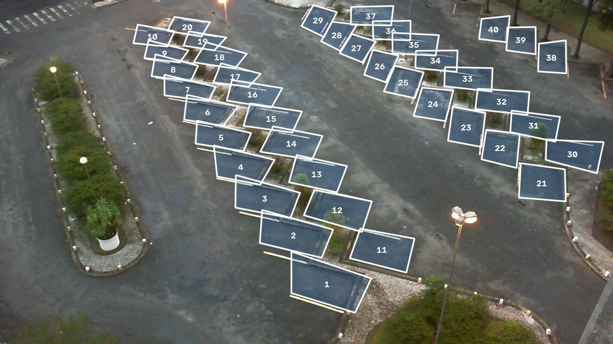

# Parking Occupancy PDI

Identificação de vagas livres e ocupadas em imagens de câmera fixa com técnicas clássicas de Processamento Digital de Imagens.
Disciplina de Processamento de Imagens — UNIVALI, 2026-02.

### Integrantes
 * Ana Clara Kniss
 * Gustavo Cezar Marquez
 * Mariana Ferreira

### Documentação e vídeos

| Material | Link |
|---|---|
| **Relatório final da M3** | [docs/relatorio_m3.md](docs/relatorio_m3.md) |
| Resultados do teste final (gerados pelo código) | [images/results/m3/teste/resultados.md](images/results/m3/teste/resultados.md) · [por condição](images/results/m3/teste/resultados_por_condicao.md) |
| Dependência da referência vazia (X3) | [images/results/m3/referencia/resultados_referencia.md](images/results/m3/referencia/resultados_referencia.md) |
| Relatório parcial da M2 | [docs/relatorio_m2.md](docs/relatorio_m2.md) |
| Proposta (revisada na M2) | [docs/proposta.md](docs/proposta.md) |
| Vídeo da M1 | [youtu.be/s6ykhlP6b3k](https://youtu.be/s6ykhlP6b3k) |
| Vídeo da M2 | *(inserir link do YouTube não listado)* |
| Vídeo / apresentação da M3 (M3-B) | *(inserir link)* |
| Slides da M3 (M3-B) | *(inserir link)* |

# Problema investigado

Dada uma sequência de imagens de um estacionamento capturadas por câmera fixa e o mapa das vagas, decidir se cada vaga está livre ou ocupada em cada quadro e informar o total de vagas livres e ocupadas e a taxa de ocupação. A decisão vem da comparação entre o quadro atual e uma imagem do mesmo estacionamento vazio, tirada pela mesma câmera no início do dia, apesar das variações de iluminação, sombras e clima.

# Contexto de aplicação

A identificação automática de vagas disponíveis pode ser aplicada em estacionamentos de locais com grande fluxo de veículos, como universidades, shopping centers, aeroportos e hospitais. Um sistema que analisa as imagens de câmeras já instaladas pode orientar motoristas e permitir o acompanhamento da ocupação, sem sensores físicos em cada vaga. Técnicas clássicas, mais leves que modelos de IA, podem reduzir o custo de implantação.

# Objetivos

**Geral:** desenvolver uma abordagem com técnicas clássicas de PDI para identificar automaticamente a ocupação de vagas a partir de imagens de câmeras fixas.

**Na M3:**

- avaliar o sistema em **dias inéditos** e inteiros (06:25–18:35), com ajuste e teste separados;
- tratar a deriva de iluminação ao longo do dia (referência adaptativa) e comparar com o baseline da M2;
- comparar a regra de limiar com um classificador de vários descritores (regressão logística);
- produzir a ocupação ao longo do dia;
- documentar dados, código, reprodução e limitações, incluindo o custo de exigir a foto do estacionamento vazio.

# Entradas e saídas

- **Entrada:** quadros JPEG do estacionamento (PKLot/UFPR05, 1280×720), um quadro do estacionamento vazio do mesmo dia e o mapa das 40 vagas (polígonos do XML do PKLot; [mapa](images/results/m3/mapa/mapa_vagas.jpg)).
- **Saídas:**
  - imagem com as vagas marcadas (verde = livre, vermelho = ocupada, amarelo = erro, quando há rótulo);
  - contagem de vagas livres e ocupadas e taxa de ocupação, por quadro e ao longo do dia (CSV e figura);
  - saídas intermediárias: diferença, máscara limiarizada, abertura, fechamento e componentes rotulados (formato na [seção 4.2 do relatório](docs/relatorio_m3.md#42-mapa-de-vagas-e-formato-das-máscaras));
  - tabela de descritores por vaga (`vagas.csv`) e resumo (`resumo.json`).



# Estágio atual

**M3 — concluída.** O sistema foi avaliado uma única vez, com parâmetros congelados antes, em **4 dias inéditos** (576 quadros, 23 019 vaga-quadros rotulados, com sol, nublado e chuva).

| Configuração | F1 | Especificidade | Taxa de falsa vaga livre | EMA contagem (vagas/imagem) | Critérios da M2 |
|---|---:|---:|---:|---:|---|
| **`B_M2`** — baseline da M2 (referência fixa, congelado) | **0,990** | 0,932 | **0,013** | **0,66** | atende aos três |
| `dupla` — sistema final declarado da M3 (referência fixa + adaptativa) | 0,974 | **0,977** | 0,048 | 1,74 | não atende ao EMA ≤ 1 |

- **O sistema da M3 perdeu para o baseline.** A referência adaptativa reduziu as falsas vagas ocupadas (FP 169 → 58), mas incorporou carros parados ao fundo nos dias úteis lotados (FN 259 → 986). A causa está analisada na [seção 8 do relatório](docs/relatorio_m3.md#8-análise-de-erros-limitações-e-ameaças-à-validade).
- **A compensação global de ganho** (experimento recomendado no parecer da M2) não teve saldo positivo nem no sol nem na chuva ([seção 7.3.1](docs/relatorio_m3.md#731-experimento-recomendado-no-parecer-diferença-simples--diferença-com-compensação-de-ganho-sob-chuva-e-sol)).
- **A foto do estacionamento vazio precisa ser do mesmo dia.** Com a de outro dia, o EMA do baseline vai de 0,02–0,38 para 0,38–3,94 ([seção 3.4](docs/relatorio_m3.md#34-referência-do-estacionamento-vazio-condições-justificativa-custo-e-limites)).

**Fora do escopo:** localização automática das vagas, outras câmeras ou estacionamentos e período noturno.

# Tecnologias

- Python 3 (testado com 3.14.8 e 3.14.10)
- OpenCV 5.0, NumPy 2.5, Matplotlib 3.11 (versões em [`requirements.txt`](requirements.txt))
- Git / GitHub

# Organização do repositório

```
├── configs/
│   ├── experimento_m2.json         # protocolo da M2: referências, ajuste/teste, configurações A/B/C
│   └── experimento_m3.json         # protocolo da M3: dados, divisão por dia, referências, grade, variantes
├── docs/
│   ├── proposta.md                 # proposta revisada e resposta ao feedback da M1
│   ├── relatorio_m2.md             # relatório parcial da M2
│   └── relatorio_m3.md             # relatório final da M3
├── images/
│   ├── input/UFPR05/               # amostra do PKLot (140 imagens + XML); dias da M3 baixados por get_data.py
│   └── results/
│       ├── exemplo/                # saídas intermediárias de run_pipeline.py
│       ├── experimentos/           # resultados da M2 (run_experiments.py)
│       └── m3/
│           ├── desenvolvimento/    # grade, validação cruzada (run_final.py --etapa desenvolvimento)
│           ├── teste/              # teste final, por dia e por condição (run_final.py, summarize_conditions.py)
│           ├── exploracao/         # ideias descartadas no desenvolvimento (explore_dev.py)
│           ├── referencia/         # X3: dependência da referência vazia (analyze_reference.py)
│           ├── mapa/               # mapa de vagas e formato das máscaras (make_space_map.py)
│           └── dia/                # ocupação ao longo de um dia (run_day.py)
├── models/sistema_final_m3.json    # parâmetros congelados antes do teste
├── src/
│   ├── parking/                    # pacote: dataset, pipeline, sequence, classifier, metrics, visualize
│   ├── run_pipeline.py             # pipeline em uma imagem
│   ├── run_day.py                  # sistema final (ou baseline) em um dia inteiro
│   ├── run_final.py                # avaliação da M3: desenvolvimento e teste
│   ├── get_data.py                 # baixa os dias da M3 (Hugging Face, revisão fixada)
│   ├── explore_dev.py              # explorações do desenvolvimento
│   ├── analyze_reference.py        # X3: sensibilidade à referência vazia
│   ├── summarize_conditions.py     # indicadores do teste por condição climática
│   ├── make_space_map.py           # mapa de vagas e máscaras
│   └── run_experiments.py          # experimentos da M2
├── tests/                          # 31 verificações automáticas
└── requirements.txt
```

# Dados

- **Origem:** PKLot (Almeida et al., 2015), estacionamento UFPR05, câmera fixa. Licença **CC BY 4.0**, que permite redistribuição com atribuição.
- **Amostra versionada (M2):** 140 imagens (37 MB) com XML em [`images/input/UFPR05/`](images/input/UFPR05/), de três manhãs. Ela permite rodar o exemplo, o mapa, a análise X3 e os testes **sem internet**. A pasta do dia de sol está nomeada `2013-14-16`; o código lê a data do nome do arquivo.
- **Dias da M3 (não versionados):** 767 imagens obtidas por `python src/get_data.py` da versão do PKLot no [Hugging Face](https://huggingface.co/datasets/Voxel51/PKLot). O script usa uma revisão fixada, confere o SHA-256 das anotações e reconstrói os XMLs. A conversão reproduz exatamente os 140 XMLs originais da amostra.
- **Divisão por dia:**

  | Conjunto | Dias | Quadros | Vagas ocupadas |
  |---|---|---:|---:|
  | Desenvolvimento | 13/04 (sáb.), 14/04 (dom.), 16/04 (ter.; só manhã) | 324 | 38,9% |
  | Teste | 13/03, 14/03, 19/03, 21/03 (dias úteis inteiros) | 576 | 89,2% |

- **Referência:** o primeiro quadro do dia com as 40 vagas livres. As condições e os limites estão na [seção 3.4 do relatório](docs/relatorio_m3.md#34-referência-do-estacionamento-vazio-condições-justificativa-custo-e-limites).
- **Listas exatas:** [`manifesto_imagens.csv`](images/results/m3/teste/manifesto_imagens.csv).

# Instalação

Na raiz do repositório:

```bash
python -m venv .venv
# Windows (PowerShell):  .venv\Scripts\Activate.ps1
# Linux/macOS:           source .venv/bin/activate
pip install -r requirements.txt
```

# Execução

### Exemplo mínimo (offline)

```bash
python src/run_pipeline.py --image images/input/UFPR05/Cloudy/2013-04-14/2013-04-14_10_00_04.jpg
```

Saída esperada:

```
Imagem: 2013-04-14_10_00_04 (Cloudy, 2013-04-14 10:00:04)
Referência: 2013-04-14_06_40_00
Configuração: B_morfologia (T = 25, tau = 0.24, abertura = 3, fechamento = 7, ganho = False)
Vagas analisadas: 40 | Ocupadas: 12 | Livres: 28 | Ocupação: 30.0%
Rótulos do XML: 12 ocupadas | acertos: 40/40
Saídas em: images/results/exemplo/2013-04-14_10_00_04
```

Ficam em `images/results/exemplo/2013-04-14_10_00_04/` as etapas `01_entrada` … `09_saida`, o `painel.jpg`, o `vagas.csv` e o `resumo.json`. Opções: `--config A_sem_morfologia | B_morfologia | C_morfologia_ganho`, `--reference <jpg>` e `--out <pasta>`.

### Um dia inteiro (offline, dia 2013-04-16 da amostra)

```bash
python src/run_day.py --dia 2013-04-16 --quadro 07:15                    # sistema final: 2061/2079 acertos
python src/run_day.py --dia 2013-04-16 --quadro 07:15 --variante B_M2    # baseline:      2064/2079 acertos
```

### Reprodução completa

```bash
python -m unittest discover -s tests              # 31 verificações
python src/make_space_map.py                      # mapa de vagas e máscaras (offline)
python src/analyze_reference.py                   # X3: dependência da referência vazia (offline)
python src/summarize_conditions.py                # teste por condição, a partir das decisões congeladas
python src/get_data.py                            # dias da M3 (~250 MB; exige internet)
python src/run_final.py --etapa desenvolvimento   # ajuste e congelamento (~5–15 min)
python src/run_final.py --etapa teste             # teste final (~5–15 min)
python src/explore_dev.py                         # explorações do desenvolvimento
python src/run_experiments.py                     # experimentos da M2
```

Os resultados são determinísticos. A lista completa, com os tempos e o que cada comando regrava, está na [seção 12 do relatório](docs/relatorio_m3.md#12-referências-e-reprodução).

# Resultados da M2 (histórico)

Nas manhãs da M2, a configuração B obteve F1 = 0,992 e EMA = 0,30. A M3 reavaliou A, B e C em dias inéditos, e as conclusões de E1 (a morfologia ajuda) e de E2 (o ganho global não compensa) se mantiveram. Os detalhes estão no [relatório da M2](docs/relatorio_m2.md#6-experimentos-resultados-e-análise).
