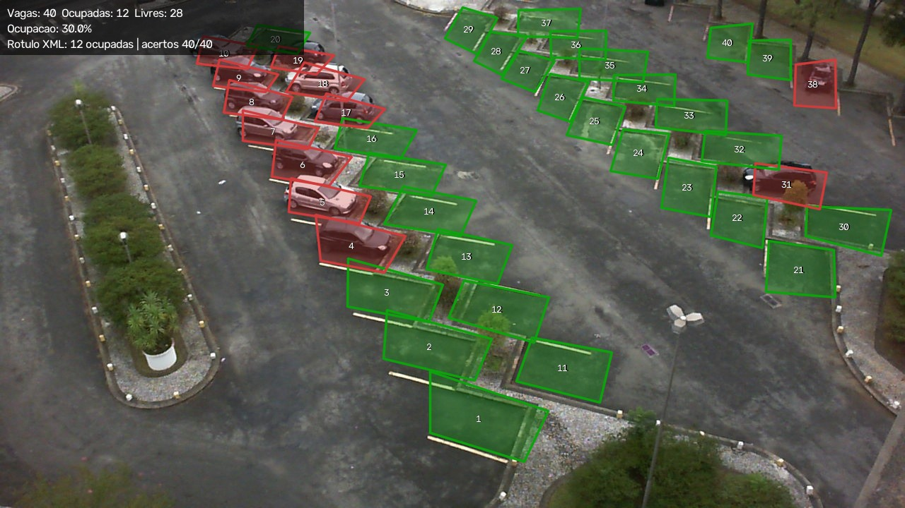

# Parking Occupancy PDI

Identificação de vagas livres e ocupadas em imagens de câmera fixa com técnicas clássicas de Processamento Digital de Imagens.
Disciplina de Processamento de Imagens — UNIVALI, 2026-02.

### Integrantes
 * Ana Clara Kniss
 * Gustavo Cezar Marquez
 * Mariana Ferreira

### Documentação e vídeos

| Material | Link |
|---|---|
| Relatório parcial da M2 | [docs/relatorio_m2.md](docs/relatorio_m2.md) |
| Proposta (revisada na M2) | [docs/proposta.md](docs/proposta.md) |
| Resultados gerados pelo código | [images/results/experimentos/resultados.md](images/results/experimentos/resultados.md) |
| Vídeo da M1 | [youtu.be/s6ykhlP6b3k](https://youtu.be/s6ykhlP6b3k) |
| Vídeo da M2 | *(inserir link do YouTube não listado)* |

# Problema investigado

Dada uma imagem de um estacionamento capturada por câmera fixa e o mapa das vagas, decidir se cada vaga está livre ou ocupada e informar o total de vagas livres e ocupadas e a taxa de ocupação. A decisão é obtida pela comparação entre o quadro atual e uma imagem de referência do mesmo estacionamento vazio, considerando variações de iluminação, sombras e clima.

# Contexto de aplicação

A identificação automática de vagas disponíveis pode ser aplicada em estacionamentos de locais com grande fluxo de veículos, como universidades, shopping centers, aeroportos e hospitais. Um sistema que analisa as imagens de câmeras já instaladas pode orientar motoristas e permitir o acompanhamento da ocupação, sem sensores físicos em cada vaga. Técnicas clássicas, mais leves que modelos de IA, podem reduzir o custo de implantação.

# Objetivos

**Geral:** desenvolver uma abordagem com técnicas clássicas de PDI para identificar automaticamente a ocupação de vagas a partir de imagens de câmeras fixas.

**Na M2:**

- implementar o pipeline executável **imagem → segmentação → morfologia → componentes → descritores → decisão → saída**;
- comparar configurações sob condições controladas, com indicadores quantitativos;
- identificar limitações e planejar a M3.

Os critérios de sucesso estão no [relatório, seção 1](docs/relatorio_m2.md#1-síntese-do-problema-e-objetivos-atuais).

# Entradas e saídas

- **Entrada:** imagem JPEG do estacionamento (PKLot/UFPR05, 1280×720), uma imagem de referência do estacionamento livre e o mapa de vagas (polígonos do XML do PKLot).
- **Saídas:**
  - imagem com as vagas marcadas (verde = livre, vermelho = ocupada, amarelo = erro, quando há rótulo);
  - contagem de vagas livres e ocupadas e taxa de ocupação;
  - saídas intermediárias: diferença, máscara limiarizada, abertura, fechamento e componentes rotulados;
  - tabela de descritores por vaga (`vagas.csv`) e resumo (`resumo.json`).



# Estágio atual

**M2 — implementação parcial concluída.** O pipeline completo executa da imagem à saída e foi avaliado em 5 479 decisões rotuladas (3 dias, 40 vagas). A configuração padrão (B: diferença + limiar global + abertura + fechamento + componentes) obteve nos dias de teste:

- F1 = 0,992;
- acurácia = 0,992;
- erro médio de contagem de 0,30 vaga por imagem.

Os erros restantes vêm de causas identificadas: carros com luminância parecida com a do asfalto, sol forte, sombras longas e um reflexo presente na referência. Elas estão analisadas no [relatório](docs/relatorio_m2.md#7-falhas-limitações-e-riscos).

**Ainda não feito (M3):** uso de cor, tratamento de sombras, referência adaptativa, classificador com vários descritores e avaliação em dias inéditos. A localização automática das vagas está fora do escopo.

# Tecnologias

- Python 3 (testado com 3.14.8)
- OpenCV 5.0, NumPy 2.5, Matplotlib 3.11 (versões em [`requirements.txt`](requirements.txt))
- Git / GitHub

# Organização do repositório

```
├── configs/experimento_m2.json   # protocolo: referências, divisão ajuste/teste, grade de busca, configurações A/B/C
├── docs/
│   ├── proposta.md               # proposta revisada e resposta ao feedback da M1
│   └── relatorio_m2.md           # relatório parcial da M2
├── images/
│   ├── input/UFPR05/             # amostra do PKLot (140 imagens + XML), ver "Dados"
│   └── results/
│       ├── exemplo/              # saídas intermediárias de src/run_pipeline.py
│       └── experimentos/         # métricas, figuras e CSVs de src/run_experiments.py
├── src/
│   ├── parking/                  # pacote: dataset, pipeline, metrics, visualize, experiment
│   ├── run_pipeline.py           # executa o pipeline em uma imagem
│   └── run_experiments.py        # ajuste, teste e comparações
└── requirements.txt
```

# Dados

- **Origem:** PKLot (Almeida et al., 2015), estacionamento UFPR05. Licença **CC BY 4.0**, que permite redistribuição com atribuição. O conjunto completo tem 12 416 imagens de três estacionamentos (PUCPR, UFPR04 e UFPR05).
- **Amostra usada:** 140 imagens (37 MB) em [`images/input/UFPR05/`](images/input/UFPR05/), cada uma com seu XML. São três manhãs da mesma câmera, com 40 vagas anotadas em cada imagem:

  | Dia | Condição | Imagens | Uso |
  |---|---|---:|---|
  | 2013-04-14 | nublado | 56 | ajuste dos limiares |
  | 2013-04-16 | sol | 53 | teste |
  | 2013-04-13 | chuva | 31 | teste |

  A pasta do dia de sol está nomeada `2013-14-16`; o código lê a data do nome do arquivo.
- **Lista das imagens e função de cada uma:** [`manifesto_imagens.csv`](images/results/experimentos/manifesto_imagens.csv).
- **Referência de avaliação:** rótulos `occupied` dos XMLs do PKLot.

Detalhes do protocolo estão no [relatório, seção 3](docs/relatorio_m2.md#3-dados-e-protocolo-experimental).

### Obter o conjunto completo

O PKLot completo não é versionado. Ele está disponível no [Hugging Face](https://huggingface.co/datasets/Voxel51/PKLot) e pode ser carregado com o FiftyOne:

```bash
python -m pip install -U fiftyone "huggingface-hub>=0.20.0"
```

```python
import fiftyone as fo
from fiftyone.utils.huggingface import load_from_hub

dataset = load_from_hub("Voxel51/PKLot")  # aceita max_samples=... para baixar só uma parte
session = fo.launch_app(dataset)          # navegador para explorar imagens e anotações
session.wait()
```

O pipeline espera a estrutura original do PKLot: `<lote>/<condição>/<dia>/<AAAA-MM-DD_HH_MM_SS>.jpg`, com o `.xml` de mesmo nome ao lado.

# Instalação

Na raiz do repositório:

```bash
python -m venv .venv
# Windows (PowerShell):  .venv\Scripts\Activate.ps1
# Linux/macOS:           source .venv/bin/activate
pip install -r requirements.txt
```

# Execução

### Exemplo mínimo

```bash
python src/run_pipeline.py --image images/input/UFPR05/Cloudy/2013-04-14/2013-04-14_10_00_04.jpg
```

Saída esperada:

```
Imagem: 2013-04-14_10_00_04 (Cloudy, 2013-04-14 10:00:04)
Referência: 2013-04-14_06_40_00
Configuração: B_morfologia (T = 25, tau = 0.24, abertura = 3, fechamento = 7, ganho = False)
Vagas analisadas: 40 | Ocupadas: 12 | Livres: 28 | Ocupação: 30.0%
Rótulos do XML: 12 ocupadas | acertos: 40/40
Saídas em: images/results/exemplo/2013-04-14_10_00_04
```

Ficam em `images/results/exemplo/2013-04-14_10_00_04/`:

- as etapas `01_entrada` … `09_saida`;
- `painel.jpg`, com todas as etapas lado a lado;
- `vagas.csv`, com os descritores por vaga;
- `resumo.json`.

Opções:

- `--config A_sem_morfologia | B_morfologia | C_morfologia_ganho` escolhe a configuração;
- `--reference <jpg>` usa outra referência; o padrão é a referência do mesmo dia definida no JSON;
- `--out <pasta>` muda a pasta de saída.

### Experimentos completos

```bash
python src/run_experiments.py
```

Ajusta T e τ no dia de ajuste, avalia as configurações A, B e C nos dias de teste, executa as comparações E1 e E2 e gera tabelas e figuras em `images/results/experimentos/`. O resumo fica em `resultados.md`. Leva cerca de 1 minuto. Todos os caminhos são relativos à raiz do repositório.

# Resultados (M2)

Indicadores nos dias de teste (sol + chuva, 3 279 decisões). Classe positiva = vaga ocupada; EMA = erro médio absoluto da contagem de vagas ocupadas por imagem.

| Configuração | FP | FN | F1 | EMA contagem |
|---|---:|---:|---:|---:|
| A — diferença + limiar | 49 | 17 | 0,982 | 0,71 |
| **B — A + abertura + fechamento (padrão)** | 16 | 11 | 0,992 | 0,30 |
| C — B + compensação global de ganho | 7 | 17 | 0,993 | 0,24 |

- **E1:** a morfologia corrigiu 42 erros e introduziu 3. Na chuva, os falsos positivos caíram de 41 para 9.
- **E2:** a compensação de ganho eliminou os falsos positivos da chuva, mas aumentou os falsos negativos no sol. O ganho calculado sobre o quadro inteiro depende da quantidade de carros na cena, por isso C não foi adotada.

A análise completa, com figuras, está no [relatório](docs/relatorio_m2.md#6-experimentos-resultados-e-análise).