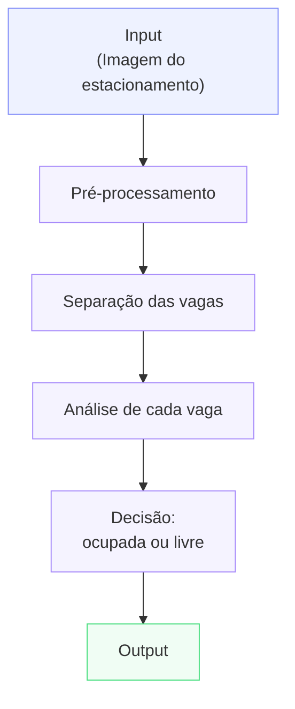

# Proposta do Projeto

> **Revisão M2 (26/10/2026).** Este documento é a proposta da M1, revisada. Mudanças desta revisão:
> - erros de digitação corrigidos;
> - nova seção *Critérios de sucesso*;
> - em cada etapa do pipeline, um item **Situação na M2** com o que foi decidido e implementado.
>
> O detalhamento técnico, os experimentos e os resultados estão no [relatório parcial da M2](relatorio_m2.md).

## Problema
Este projeto investiga a identificação automática de vagas livres e ocupadas em estacionamentos a partir de imagens obtidas por câmeras fixas, utilizando técnicas clássicas de Processamento Digital de Imagens.

A situação inicial considerada é a existência de imagens de um mesmo estacionamento capturadas ao longo do tempo, com enquadramento fixo e com as regiões correspondentes às vagas previamente conhecidas. A partir dessas imagens, pretende-se analisar individualmente cada vaga e determinar se ela se encontra livre ou ocupada.

O problema envolve diretamente processamento e análise de imagens, pois a decisão sobre o estado da vaga será obtida a partir da comparação visual entre uma imagem atual e uma imagem de referência da mesma região em estado livre.

Entre os fatores que podem dificultar essa comparação estão:
* variações de iluminação;
* presença de sombras;
* mudanças nas condições climáticas;
* reflexos;
* diferenças de intensidade de pixels;
* veículos com cores similares às do ambiente;
* pequenas alterações visuais entre diferentes momentos de captura.

A proposta inicial consiste em investigar se técnicas como pré-processamento, diferenças absolutas entre imagens, limiarização e operações morfológicas são suficientes para identificar alterações significativas nas regiões correspondentes às vagas.

A principal questão investigada pelo projeto é:

Como identificar vagas livres e ocupadas em imagens de estacionamentos utilizando técnicas clássicas de Processamento Digital de Imagens baseadas na comparação entre imagens, considerando variações de iluminação, sombras e condições ambientais?

A partir das classificações individuais, também deverá ser possível obter informações gerais sobre o estacionamento, como:
* quantidade total de vagas analisadas;
* quantidade de vagas livres;
* quantidade de vagas ocupadas;
* percentual de ocupação do estacionamento.

O projeto está delimitado a imagens obtidas por câmeras fixas e a vagas cujas regiões já estejam previamente identificadas. Dessa forma, o projeto não tem como objetivo determinar automaticamente a localização das vagas, mas analisar o estado de ocupação das regiões conhecidas.

## Contexto de Aplicação
Estacionamentos com grande quantidade de vagas podem apresentar dificuldades para que motoristas identifiquem rapidamente a disponibilidade de espaços livres.

Uma possível abordagem para obter essas informações é a instalação de sensores físicos individuais em cada vaga. Entretanto, outra possibilidade consiste em utilizar imagens provenientes de câmeras já posicionadas no estacionamento e realizar o processamento dessas imagens para estimar sua ocupação.

Nesse contexto, uma solução baseada em Processamento Digital de Imagens poderia utilizar imagens capturadas periodicamente para determinar o estado das vagas e produzir informações sobre a disponibilidade do estacionamento.

Uma possível aplicação seria um sistema de monitoramento capaz de produzir informações como:

Total de vagas: 40
Vagas ocupadas: 27
Vagas livres: 13

Taxa de ocupação: 67,5%

Essas informações poderiam posteriormente ser utilizadas em:
* painéis de monitoramento;
* sistemas de orientação aos motoristas;
* acompanhamento da utilização do estacionamento;
* análise histórica de ocupação;
* identificação de horários com maior ou menor utilização.

Neste projeto, entretanto, o foco não está no desenvolvimento de um sistema comercial completo. O principal objetivo é investigar a viabilidade de técnicas clássicas de PDI para extrair informações sobre a ocupação diretamente das imagens.

Para realizar os experimentos é utilizado o dataset PKLot (Almeida et al., 2015), disponibilizado por meio da plataforma Hugging Face sob licença CC BY 4.0:

[Hugging Face](https://huggingface.co/datasets/Voxel51/PKLot)

O conjunto possui imagens de estacionamentos capturadas por câmeras fixas e apresenta diferentes situações de ocupação e condições ambientais.

Foi selecionado um subconjunto de imagens provenientes do mesmo estacionamento e da mesma câmera (UFPR05), de forma a manter o enquadramento constante e facilitar os experimentos de comparação entre imagens. Para avaliar o comportamento da abordagem diante de diferentes condições climáticas e de iluminação, o subconjunto inclui uma manhã nublada, uma ensolarada e uma chuvosa.

## Evolução da proposta e resposta ao feedback da M1

A proposta do projeto foi mantida no que é central ao problema: câmeras fixas, vagas previamente conhecidas e análise por comparação entre imagens em estado livre e ocupado.

### O que foi mantido
- Uso de câmeras fixas e regiões de vaga previamente conhecidas, como sugerido na proposta original.
- Abordagem baseada na comparação da imagem atual com uma imagem de referência da mesma vaga em estado livre.
- Uso de técnicas clássicas de PDI, como diferença absoluta entre imagens, limiarização e operações morfológicas.
- Objetivo de produzir classificação por vaga e estimar o nível de ocupação do estacionamento.

### O que foi corrigido
- **Escopo:** a identificação automática das vagas não é tratada no projeto. As áreas de vaga vêm dos polígonos do XML do conjunto de dados, o que preserva a consistência do problema e evita sobrecarga de processamento.
- **Dataset:** em vez de versionar o conjunto completo do PKLot no repositório, é utilizado um subconjunto pequeno (140 imagens), com instruções de obtenção e um manifesto das imagens usadas.
- **Documentação e execução:** o README e o relatório registram comandos, dependências, protocolo e critérios de avaliação.

### O que foi substituído (M2)
- **Técnicas de separação das vagas:** a detecção de linhas, bordas e a transformada de Hough foram substituídas pelos polígonos anotados do PKLot.
- **Segunda comparação:** a comparação "limiar global vs. limiar adaptativo" foi substituída por "sem vs. com compensação global de ganho". A hipótese a testar é a mudança de brilho entre a referência e o quadro atual, e a compensação ataca essa causa sem alterar o resto do pipeline. O limiar adaptativo, aplicado à imagem de diferença, mudaria o significado do descritor de área. A justificativa completa está no [relatório, seção 2.2](relatorio_m2.md#22-o-que-foi-mantido-corrigido-ou-substituído).

### Resposta técnica ao feedback da M1
1. **Versionamento do dataset:** o projeto mantém uma amostra representativa para implementação e experimentação, sem armazenar o conjunto completo do PKLot no repositório. A origem, a licença (CC BY 4.0) e o procedimento de download estão documentados no README. O arquivo `images/results/experimentos/manifesto_imagens.csv` lista cada imagem usada.
2. **Escopo da detecção de vagas:** a M2 se limita às coordenadas de vagas já conhecidas (polígonos do XML), lidas por `src/parking/dataset.py`. A segmentação automática de vagas exige outra camada de modelagem e introduziria variabilidade desnecessária para verificar a proposta principal, que é classificar a ocupação.
3. **Imagem de referência e variação ambiental:** uma referência por dia, da mesma câmera, escolhida como o primeiro quadro com o estacionamento totalmente livre. A sensibilidade a iluminação, sombra e clima foi testada em dias de sol e de chuva, diferentes do dia de ajuste; os resultados estão no relatório, seções 6 e 7.
4. **Baseline e avaliação:** foram comparadas três configurações em duas comparações controladas:
   - E1: diferença absoluta sem e com morfologia;
   - E2: sem e com compensação de ganho.

   Os indicadores são acurácia, precisão, revocação, especificidade, F1, contagem de falsos positivos e negativos e erro de contagem por imagem.
5. **Documentação e execução:** o repositório traz `requirements.txt`, os scripts `src/run_pipeline.py` e `src/run_experiments.py`, o protocolo em `configs/experimento_m2.json` e um exemplo com saída esperada no README.

### Objetivos para a M2 e situação
- Implementar um pipeline parcial executável para análise de ocupação em vagas conhecidas. **Concluído.**
- Validar a comparação entre imagem atual e referência, com pré-processamento e morfologia adequados. **Concluído** (E1).
- Comparar pelo menos duas configurações controladas para identificar a mais robusta. **Concluído** (E1 e E2).
- Produzir resultados numéricos e imagens intermediárias (diferença absoluta, limiarização, máscaras, componentes rotulados). **Concluído.**
- Identificar limitações concretas, como sombras, reflexos e variação de iluminação, e definir o plano para a M3. **Concluído** (relatório, seções 7 e 8).

### Rastreabilidade das mudanças
- A revisão da proposta e do escopo está documentada neste arquivo; a resposta detalhada ao feedback está no [relatório, seção 2](relatorio_m2.md#2-resposta-ao-feedback-e-evolução-desde-a-m1).
- A implementação está em `src/`, os parâmetros em `configs/experimento_m2.json` e as evidências (métricas, figuras, CSVs) em `images/results/`.
- O README reflete o problema, os objetivos, o estágio atual e as instruções de execução.

## Objetivo

### Objetivo Geral

Desenvolver uma abordagem computacional com técnicas clássicas de Processamento Digital de Imagens para identificar automaticamente a ocupação de vagas de estacionamento a partir de imagens obtidas por câmeras fixas.

### Objetivos Específicos

- Selecionar e organizar um conjunto inicial de imagens.
- Investigar técnicas clássicas de processamento de imagens que possam ser utilizadas no pré-processamento para padronizar as imagens antes da análise.
- Investigar técnicas para identificação do estado de ocupação de cada vaga para determinar se está livre ou ocupada.
- Desenvolver uma estratégia de classificação das regiões analisadas em vagas livres e ocupadas.
- Avaliar o desempenho da abordagem desenvolvida por meio de métricas quantitativas, comparando as classificações obtidas com os rótulos reais fornecidos pelo dataset.
- Determinar, a partir da classificação das vagas, informações sobre a ocupação do estacionamento, como quantidade de vagas livres, quantidade de vagas ocupadas e percentual de ocupação.

### Critérios de sucesso

Para o sistema final (M3), avaliado em dias do UFPR05 **não usados** na M2:

- F1 ≥ 0,95 em cada dia de teste (classe positiva = vaga ocupada);
- especificidade ≥ 0,98 em dias de chuva (poucos alarmes falsos com o chão molhado);
- erro médio absoluto da contagem de vagas ocupadas ≤ 1 vaga por imagem.

Na M2, a configuração padrão atingiu F1 = 0,996 (sol) e 0,684 (chuva), especificidade de 0,992 na chuva e erro médio de contagem de 0,30 vaga por imagem. Esses números são parciais: os dias de teste foram usados também na análise de erros.

## Entrada e saída esperadas

### Input
- Finalidade: Fornecer as imagens de estacionamento a serem analisadas no pipeline;
- Técnicas consideradas: N/A;
- Informação recebida: Imagens do dataset;
- Informação produzida: Imagens selecionadas para o envio ao pré-processamento;
- Principais dúvidas: Qual conjunto de imagens utilizar entre os três disponíveis, ou utilizar dos três.
- **Situação na M2:** dúvida resolvida. Foi usado só o UFPR05 (uma câmera), com três manhãs: nublada (ajuste), ensolarada e chuvosa (teste). São 140 imagens com 40 vagas anotadas cada.

### Pré-processamento
- Finalidade: Preparar, normalizar e padronizar as imagens para facilitar etapas seguintes;
- Técnicas consideradas: Conversão para escala de cinza, ajuste de contraste, filtragem e redução de ruído;
- Informação recebida: Imagens de estacionamento a serem pré-processadas;
- Informação produzida: Imagens pré-processadas;
- Principais dúvidas: Quais técnicas de pré-processamento serão as mais adequadas.
- **Situação na M2:** implementado como conversão para cinza mais filtro gaussiano 5×5. A compensação global de ganho foi testada (E2) e não foi adotada como padrão. O descarte da cor causa falsos negativos em carros vermelhos e escuros; o uso de cor está planejado para a M3.

### Separação das vagas
- Finalidade: Identificar e delimitar a área de cada vaga de estacionamento, determinando seus limites para que possam ser analisadas individualmente;
- Técnicas consideradas: Delimitação manual das vagas, detecção de linhas e bordas, análise de contornos e transformada de Hough;
- Informação recebida: imagens pré-processadas do estacionamento;
- Informação produzida: Imagens e metadados de vagas já delimitadas em suas extremidades;
- Principais dúvidas: Quais técnicas de delimitação de espaço utilizar para medir e separar as vagas.
- **Situação na M2:** substituído pela delimitação a partir dos polígonos anotados no XML do PKLot (o mapa fixo da câmera), rasterizados como máscaras. Detecção de linhas e Hough ficaram fora do escopo.

### Análise de cada vaga
- Finalidade: Analisar individualmente cada região de vaga e identificar alterações visuais que possam indicar a presença de um veículo;
- Técnicas consideradas: Comparação com imagem de referência da vaga livre, diferença absoluta entre imagens, análise de intensidade, limiarização, cálculo da proporção dos pixels alterados e operações morfológicas como abertura e fechamento;
- Informação recebida: Imagem da vaga delimitada e imagem de referência da mesma vaga em estado livre;
- Informação produzida: Máscara ou medida quantitativa representando o nível de alteração existente na região da vaga.
- Principais dúvidas: Qual técnica de comparação apresenta melhor resultado, qual valor de limiar utilizar para considerar um pixel como significativamente alterado e como reduzir alterações provocadas por sombras, iluminação, chuva ou outros fatores externos.
- **Situação na M2:** implementado como diferença absoluta, limiar global, abertura (3×3), fechamento (7×7) e componentes conexos dentro de cada vaga. São calculados 10 descritores por vaga (área, perímetro, solidez, fração alterada, densidade de bordas etc.). O limiar T = 25 foi escolhido por busca em grade no dia de ajuste. A morfologia reduziu os erros de 66 para 27 no teste (E1).

### Decisão
- Finalidade: Determinar se cada vaga analisada deve ser classificada como livre ou ocupada a partir das informações extraídas na etapa anterior;
- Técnicas consideradas: Definição de limiar baseado na proporção de pixels alterados, análise da área modificada e comparação experimental com os estados reais informados pelo dataset;
- Informação recebida: Medidas ou máscaras representando o nível de alteração observado em cada vaga;
- Informação produzida: Classificação individual de cada vaga como livre ou ocupada;
- Principais dúvidas: Qual valor de limiar de ocupação apresenta melhor separação entre vagas livres e ocupadas e se esse valor poderá ser utilizado em diferentes condições de iluminação, clima e estacionamento.
- **Situação na M2:** a vaga é ocupada se o maior componente cobre pelo menos τ = 0,24 da área da vaga, valor ajustado no dia nublado. O mesmo τ funcionou no sol e na chuva (F1 total de 0,992 no teste); os erros restantes vêm de casos em que a referência deixou de representar a vaga livre. Na M3 será avaliado um classificador com vários descritores.

### Output
- Finalidade: Apresentar de forma clara os resultados obtidos pelo processamento das imagens e fornecer informações sobre a ocupação geral do estacionamento;
- Técnicas consideradas: Geração de imagem com marcações sobre as vagas, contagem dos estados detectados e cálculo da taxa percentual de ocupação.
- Informação recebida: Classificação individual das vagas como livres ou ocupadas;
- Informação produzida: Imagem com identificação visual das vagas, quantidade de vagas livres e ocupadas e taxa estimada de ocupação do estacionamento;
- Principais dúvidas: Qual forma de apresentação permitirá interpretar melhor os resultados e quais informações deverão ser exibidas para facilitar a avaliação do desempenho do método.
- **Situação na M2:** a saída é uma imagem com as vagas em verde (livre) ou vermelho (ocupada), com os erros em amarelo quando há rótulo, as contagens, a taxa de ocupação, a tabela de descritores por vaga (CSV) e uma série temporal de ocupação por dia (`fig_contagem_temporal.png`).
