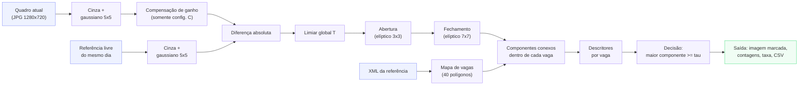
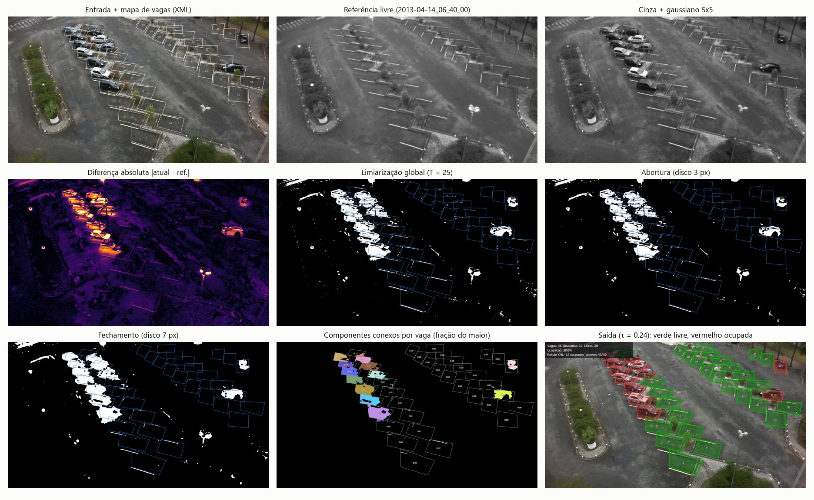
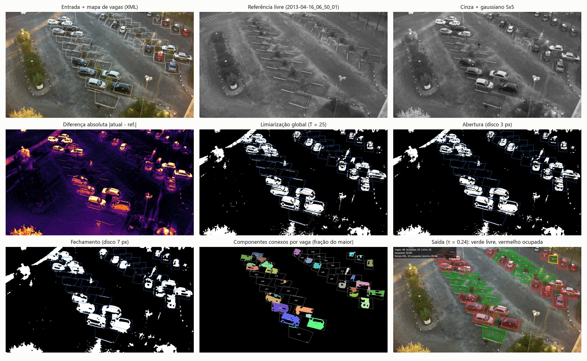
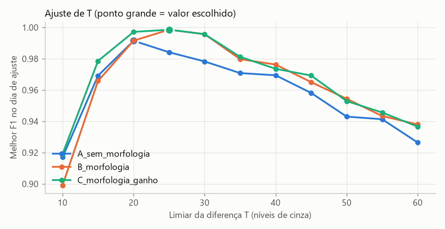
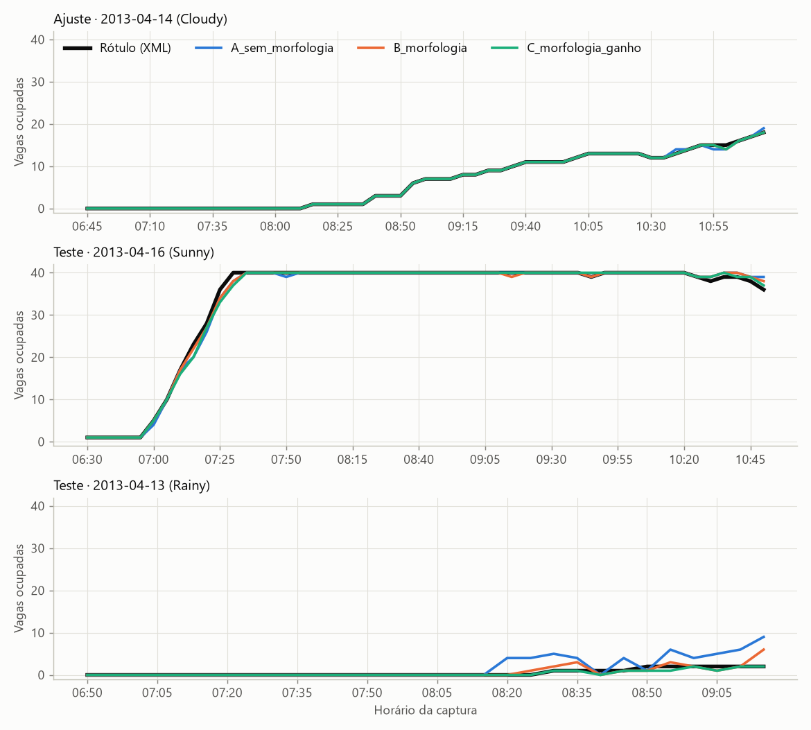
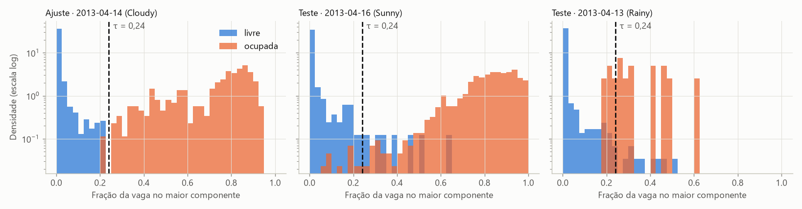
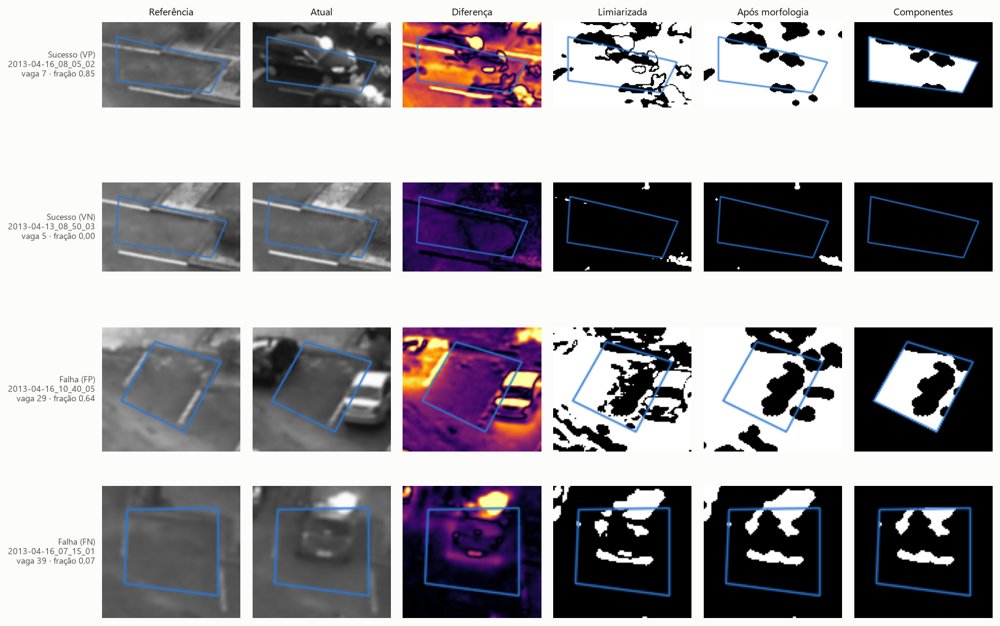
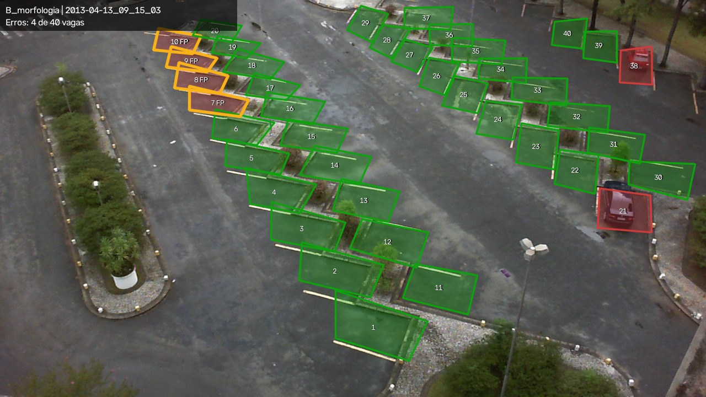
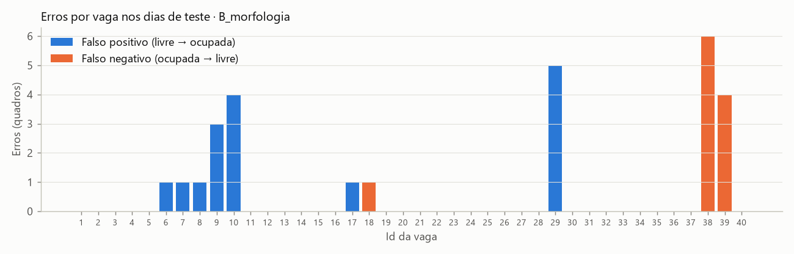
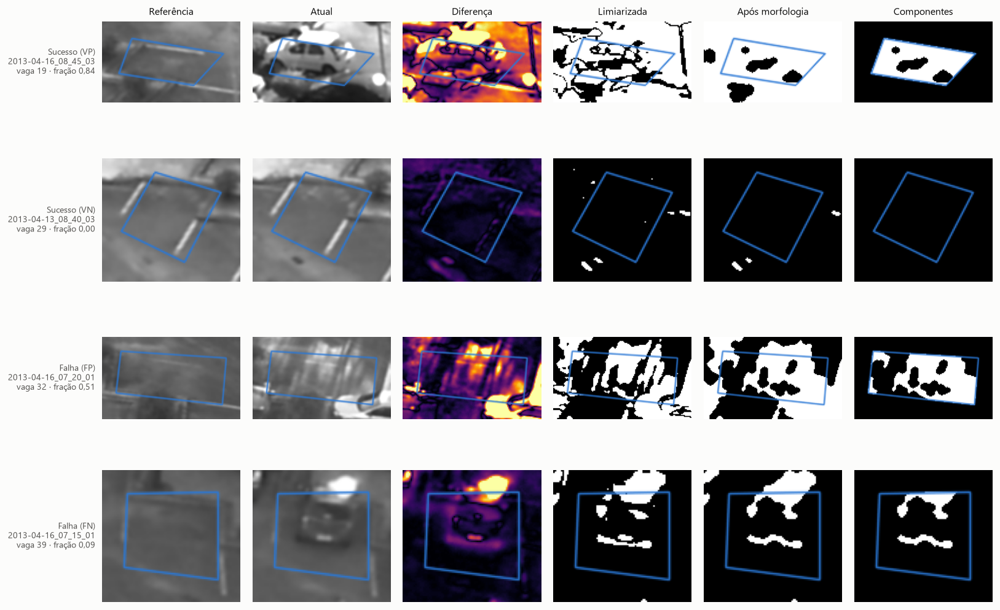

# Relatório parcial — M2

**Projeto:** Parking Occupancy PDI — identificação de vagas livres e ocupadas com Processamento Digital de Imagens clássico
**Integrantes:** Ana Clara Kniss · Gustavo Cezar Marquez · Mariana Ferreira
**Disciplina:** Processamento de Imagens — 2026-02 · Etapa M2

Todos os números deste relatório foram gerados por `python src/run_experiments.py` e estão em [`images/results/experimentos/resultados.md`](../images/results/experimentos/resultados.md) e nos CSVs da mesma pasta. A seção 9 traz os comandos para reproduzi-los.

---

## 1. Síntese do problema e objetivos atuais

**Problema.** Dada uma imagem de um estacionamento capturada por câmera fixa e o mapa das vagas (polígonos conhecidos), decidir se cada vaga está **livre** ou **ocupada** e, a partir disso, informar o total de vagas ocupadas, livres e a taxa de ocupação. A decisão é obtida pela comparação visual entre o quadro atual e uma **imagem de referência do mesmo estacionamento vazio**.

**Questão investigada.** Técnicas clássicas (diferença entre imagens, limiarização, morfologia e análise de componentes) são suficientes para classificar a ocupação, considerando variações de iluminação, sombras e clima?

**Objetivos da M2 (atendidos):**

1. Implementar um pipeline executável **entrada → processamento → saída verificável** para vagas conhecidas — [seção 4](#4-pipeline-implementado-e-etapas-pendentes).
2. Produzir saídas intermediárias (diferença, máscara limiarizada, máscara após morfologia, componentes rotulados, tabela de descritores) — [seção 4](#4-pipeline-implementado-e-etapas-pendentes) e [`images/results/exemplo/`](../images/results/exemplo/).
3. Comparar configurações sob condições controladas, com indicador quantitativo — [seção 6](#6-experimentos-resultados-e-análise).
4. Identificar limitações concretas e planejar a M3 — [seções 7](#7-falhas-limitações-e-riscos) e [8](#8-plano-de-conclusão-m3).

**Critérios de sucesso para o sistema final (M3).** Avaliados em dias **inéditos** (não usados na M2): F1 ≥ 0,95 em cada dia de teste, especificidade ≥ 0,98 em dias de chuva e erro médio absoluto de contagem ≤ 1 vaga por imagem. Na M2, esses valores servem como referência para interpretar os resultados parciais.

---

## 2. Resposta ao feedback e evolução desde a M1

### 2.1 Orientações recebidas e ações tomadas

| # | Orientação da M1 (registrada em [`proposta.md`](proposta.md)) | Ação na M2 | Evidência |
|---|---|---|---|
| 1 | Não versionar o PKLot completo | Mantida no repositório apenas uma amostra de 140 imagens (3 dias, 37 MB), com licença, origem e procedimento de obtenção do conjunto completo documentados. Um manifesto lista cada imagem usada e sua função no protocolo. | [`README.md`](../README.md#dados), [`manifesto_imagens.csv`](../images/results/experimentos/manifesto_imagens.csv) |
| 2 | Delimitar o escopo da separação de vagas | A localização automática de vagas saiu do escopo. As vagas vêm dos polígonos do XML do PKLot (o mapa fixo da câmera), lidos da imagem de referência. | [`dataset.py`](../src/parking/dataset.py) (`load_spaces`), [`pipeline.py`](../src/parking/pipeline.py) (`build_regions`) |
| 3 | Justificar a imagem de referência e testar a variação ambiental | Uma referência por dia: o primeiro quadro com o estacionamento todo livre. O teste usa dias de sol forte e de chuva, diferentes do dia de ajuste. | [`experimento_m2.json`](../configs/experimento_m2.json) (`references`), seções 3 e 6 |
| 4 | Ter baseline e avaliação quantitativa | Três configurações (A, B, C) e duas comparações controladas (E1, E2), com acurácia, precisão, revocação, especificidade, F1 e erro de contagem por imagem. | [`resultados.md`](../images/results/experimentos/resultados.md), [`metricas.csv`](../images/results/experimentos/metricas.csv) |
| 5 | Documentar a execução | README com instalação, comandos e exemplo com saída esperada; dependências com versões; protocolo e parâmetros em JSON. | [`README.md`](../README.md), [`requirements.txt`](../requirements.txt) |

### 2.2 O que foi mantido, corrigido ou substituído

- **Mantido:** comparação com uma referência livre, diferença absoluta, limiarização e morfologia (abertura e fechamento), além da saída com contagens e taxa de ocupação, como previsto na M1.
- **Corrigido:**
  - A etapa *Separação das vagas* previa detecção de linhas e transformada de Hough. Agora usa os polígonos anotados, conforme o item 2 da tabela.
  - O *pré-processamento* foi definido como conversão para cinza mais filtro gaussiano 5×5.
  - Foram incluídos critérios de sucesso numéricos (seção 1).
- **Substituído:** a M1 citava "limiar global vs. limiar adaptativo" como uma das comparações possíveis. A segunda comparação (E2) testa, em vez disso, a **compensação global de ganho**.
  - *Motivo:* a hipótese a testar é que o erro vem da mudança de brilho entre a referência (amanhecer) e o quadro atual. A compensação ataca essa causa diretamente e deixa o resto do pipeline idêntico, o que mantém a comparação controlada.
  - *Por que não o limiar adaptativo:* aplicado à imagem de diferença, ele marcaria apenas o que é localmente mais claro que a vizinhança. Em uma vaga inteiramente ocupada (diferença alta e homogênea) sobrariam quase só as bordas do carro, o que mudaria o significado do descritor de área.
  - O limiar adaptativo continua como alternativa para a M3.
- **Novo:** análise de componentes conexos por vaga e um conjunto de descritores de região, que é o foco da M2.

---

## 3. Dados e protocolo experimental

### 3.1 Origem e condições de uso

As imagens vêm do **PKLot** (Almeida et al., 2015), estacionamento **UFPR05**: câmera fixa no alto de um prédio da UFPR, imagens JPEG de 1280×720 px capturadas a cada 5 minutos. O PKLot é distribuído sob licença **CC BY 4.0** (página do dataset no Hugging Face, `Voxel51/PKLot`), que permite redistribuição com atribuição.

Cada imagem tem um XML com o polígono (`contour`), o retângulo rotacionado (`rotatedRect`) e o rótulo `occupied` de **40 vagas**. As demais vagas visíveis na imagem não são anotadas e, por isso, não são avaliadas.

### 3.2 Subconjunto usado

| Dia | Condição (PKLot) | Quadros | Horário | Vagas ocupadas por quadro | Vaga-quadros ocupados | Papel no protocolo |
|---|---|---:|---|---|---:|---|
| 2013-04-14 | Cloudy | 56 | 06:40 – 11:15 | 0 – 18 | 353 de 2 200 | **ajuste** (55) + referência (1) |
| 2013-04-16 | Sunny | 53 | 06:30 – 10:50 | 0 – 40 | 1 752 de 2 079 | **teste** (52) + referência (1) |
| 2013-04-13 | Rainy | 31 | 06:45 – 09:15 | 0 – 2 | 16 de 1 200 | **teste** (30) + referência (1) |

São 140 imagens no total, sendo 137 avaliadas (5 479 vaga-quadros rotulados). Cada imagem é identificada pelo nome do arquivo (`AAAA-MM-DD_HH_MM_SS`). A lista completa, com a função de cada imagem, está em [`manifesto_imagens.csv`](../images/results/experimentos/manifesto_imagens.csv).

**Critérios de seleção.** Para cada condição climática foi escolhida uma manhã completa da mesma câmera, em quadros consecutivos que cobrem o enchimento do estacionamento. Isso inclui situações típicas (asfalto com luz difusa) e difíceis:

- penumbra do amanhecer;
- sol baixo com sombras longas;
- asfalto molhado com reflexos;
- veículos escuros ou vermelhos, com luminância próxima à do asfalto.

**Por que este tamanho.** O objetivo da M2 é verificar o pipeline e comparar configurações, não estimar o desempenho geral no PKLot. Três dias com 40 vagas dão 5 479 decisões rotuladas, com as duas classes e as três condições climáticas, e permitem inspecionar os erros um a um. A generalização para dias inéditos fica para a M3 (seção 8).

**Observações sobre os dados:**

- A pasta do dia ensolarado está nomeada `2013-14-16`, mas as imagens são de 2013-04-16. O código lê a data do **nome do arquivo**, não da pasta.
- Uma vaga não tem rótulo no XML (`2013-04-16_07_25_01`, vaga 15) e foi excluída da avaliação. Por isso o dia ensolarado tem 2 079 vaga-quadros, e não 2 080.

### 3.3 Referência de avaliação (ground truth)

Os rótulos `occupied` dos XMLs foram produzidos pelos autores do PKLot; o grupo não os alterou. Limitações:

1. O rótulo é binário: não há grau de ocupação nem marcação de veículo sobre duas vagas.
2. Só 40 vagas são anotadas.
3. Não medimos a taxa de erro de anotação. Os casos de erro foram inspecionados visualmente e nenhum se mostrou erro de rótulo.

### 3.4 Separação entre ajuste e avaliação

- **A divisão é feita por dia.** Quadros consecutivos do mesmo dia são quase idênticos (5 min de intervalo), então dividir quadros de um mesmo dia entre ajuste e teste inflaria os resultados. Nenhum dia aparece nos dois conjuntos.
- **Ajuste:** dia nublado (2013-04-14). É o único conjunto usado para escolher T (limiar da diferença) e τ (limiar de ocupação) por busca em grade:
  - T ∈ {10, 15, …, 60} e τ ∈ {0,01, …, 0,99};
  - critério: maior F1, com a classe positiva sendo "ocupada";
  - desempate: vence o T com a faixa de τ ótimos mais larga, e τ é a mediana dessa faixa.
- **Teste:** dias ensolarado e chuvoso, avaliados com parâmetros congelados. As três configurações foram definidas no arquivo JSON **antes** da execução no teste.
- **Referências:** uma por dia, o primeiro quadro com as 40 vagas livres (`2013-04-14_06_40_00`, `2013-04-16_06_50_01`, `2013-04-13_06_45_01`), excluídas da avaliação. A escolha foi feita por inspeção visual e confirmada pelos rótulos. Isso representa a hipótese operacional de que o sistema registra uma imagem do estacionamento vazio no início do dia; os rótulos **não** são usados na decisão de nenhum quadro avaliado.
- **Limitação do protocolo:** o dia de ajuste é "fácil" (F1 ≈ 1 em todas as configurações) e quase não discrimina as configurações; as diferenças aparecem no teste. Além disso, os dias de teste foram usados na análise de erros desta etapa. Por isso a M3 precisa de dias novos para a avaliação final.

---

## 4. Pipeline implementado e etapas pendentes



### 4.1 Organização do código

| Arquivo | Responsabilidade |
|---|---|
| [`src/parking/dataset.py`](../src/parking/dataset.py) | Leitura dos XMLs (polígono e rótulo de cada vaga) e listagem cronológica das imagens |
| [`src/parking/pipeline.py`](../src/parking/pipeline.py) | Todas as etapas de PDI, de `preprocess` a `analyze`, e a configuração `PipelineConfig` |
| [`src/parking/metrics.py`](../src/parking/metrics.py) | Matriz de confusão, indicadores, erro de contagem e AUC |
| [`src/parking/visualize.py`](../src/parking/visualize.py) | Imagens intermediárias e gráficos |
| [`src/parking/experiment.py`](../src/parking/experiment.py) | Leitura do JSON, caminhos relativos e carregamento da referência |
| [`src/run_pipeline.py`](../src/run_pipeline.py) | Executa o pipeline em **uma** imagem e salva todas as saídas intermediárias |
| [`src/run_experiments.py`](../src/run_experiments.py) | Ajuste, teste, comparações, figuras e tabelas |
| [`configs/experimento_m2.json`](../configs/experimento_m2.json) | Protocolo: referências, divisão por dia, grade de busca, configurações e comparações |

### 4.2 Etapas: finalidade, entradas, saídas e parâmetros

| # | Etapa (função) | Finalidade | Entrada → saída | Parâmetros e justificativa |
|---|---|---|---|---|
| 0 | Mapa de vagas (`load_spaces`, `build_regions`) | Delimitar cada vaga | XML → máscara booleana do polígono dentro do retângulo envolvente | Polígonos do PKLot. A área das vagas vai de 2 337 px (vaga 19, ao fundo) a 12 979 px (vaga 1, à frente) por causa da perspectiva; por isso os descritores são normalizados pela área |
| 1 | Pré-processamento (`preprocess`) | Reduzir ruído do sensor, artefatos de JPEG e pequenos desalinhamentos antes da comparação pixel a pixel | BGR → cinza suavizado (uint8) | Gaussiano 5×5 (σ = 1,1 px, calculado pelo OpenCV). A cor é descartada porque a comparação é de luminância (ver a limitação na seção 7) |
| 2 | Compensação de ganho (`compensate_gain`), **só na config. C** | Igualar o brilho global do quadro ao da referência | cinza → cinza × g | g = mediana(referência) / mediana(quadro). A mediana resiste a valores extremos, mas não a mudanças de conteúdo (seção 6.3) |
| 3 | Diferença absoluta (`cv2.absdiff`) | Destacar o que mudou em relação ao estacionamento vazio. O valor absoluto capta tanto carros mais claros quanto mais escuros que o asfalto | 2 imagens cinza → mapa de diferença (0–255) | — |
| 4 | Limiarização global (`cv2.threshold`) | Segmentar pixels "alterados" | diferença → máscara binária | **T = 25** níveis de cinza (B e C) e T = 20 (A), ajustados no dia nublado |
| 5a | Abertura (`apply_morphology`) | Remover pontos e filamentos isolados (ruído, gotas, textura do asfalto) sem apagar veículos, que têm dezenas de pixels | máscara → máscara | Elemento elíptico 3×3. Remove estruturas com menos de 3 px de largura |
| 5b | Fechamento (`apply_morphology`) | Unir fragmentos do mesmo veículo (para-brisa, teto e reflexos que coincidem com o brilho do asfalto) em uma região contígua | máscara → máscara | Elemento elíptico 7×7. Preenche lacunas de até ~6 px. É isotrópico porque os carros aparecem em várias orientações |
| 6 | Componentes conexos (`describe_space`) | Separar o "objeto" principal do ruído disperso dentro de cada vaga | máscara ∩ polígono → rótulos (vizinhança-8) | Componentes com menos de 15 px não entram em `n_components` |
| 7 | Descritores (`describe_space`) | Representar cada vaga por atributos mensuráveis | rótulos, diferença e cinza → linha do CSV | Tabela 4.3 |
| 8 | Decisão (`analyze`) | Classificar a vaga | `largest_frac` → ocupada se ≥ τ | **τ = 0,24** (faixa ótima no ajuste: 0,23–0,26) |
| 9 | Saída (`draw_result`) | Comunicar o resultado | decisões → imagem com vagas verdes/vermelhas, erros em amarelo (quando há rótulo), contagens, taxa, `vagas.csv` e `resumo.json` | — |

**Por que "fração do maior componente" decide.** Um veículo forma uma região grande e contígua após o fechamento. Ruído e sombras finas formam muitos componentes pequenos. Somar todos os pixels alterados (`frac_changed`) deixaria o ruído disperso se acumular; o maior componente ignora esse ruído.

### 4.3 Descritores calculados por vaga

Todos são calculados dentro do polígono da vaga, sobre a máscara final da configuração (após a morfologia, quando houver). Ficam salvos em `vagas.csv` (por imagem) e em `vagas_<config>.csv` (todos os quadros).

| Atributo | Cálculo | Unidade |
|---|---|---|
| `area_px` | pixels dentro do polígono | px |
| `frac_changed` | pixels de primeiro plano na vaga ÷ `area_px` | adimensional (0–1) |
| `n_components` | nº de componentes 8-conexos com área ≥ 15 px | contagem |
| `largest_area_px` | área do maior componente | px |
| `largest_frac` | `largest_area_px` ÷ `area_px` — **descritor de decisão** | adimensional (0–1) |
| `largest_perimeter_px` | comprimento do contorno externo do maior componente (`cv2.arcLength`) | px |
| `largest_solidity` | área do contorno ÷ área do fecho convexo do maior componente | adimensional (0–1) |
| `mean_diff` | média da diferença absoluta na vaga | níveis de cinza (0–255) |
| `edge_density` | fração de pixels de borda (Canny, limiares 50/150) no quadro atual | adimensional (0–1) |
| `gray_std` | desvio padrão do cinza do quadro atual na vaga | níveis de cinza |

`edge_density` e `gray_std` **não usam a referência**. Foram incluídos para avaliar, na M3, um classificador que não dependa só da diferença (seção 6.4).

### 4.4 Saídas intermediárias



**Figura 1** — Pipeline completo (configuração B) no quadro `2013-04-14_10_00_04` (nublado, 10:00). Na **diferença**, os veículos aparecem como regiões claras e o asfalto livre fica escuro. A **limiarização** (T = 25) ainda deixa pontos espalhados, como o poste à direita e os riscos das faixas. A **abertura** remove os pontos, e o **fechamento** une as partes de cada carro em uma única região. Em **componentes**, cada região rotulada recebe uma cor e o número na vaga é a fração do maior componente: neste quadro, as vagas ocupadas ficam entre 0,44 e 0,89, e as livres não passam de 0,22. **Saída:** 12 ocupadas de 40 (30,0 %), 40/40 de acerto contra o XML.



**Figura 2** — O mesmo pipeline em `2013-04-16_07_15_01` (teste, sol baixo, enchimento rápido). A referência (06:50) foi capturada antes do nascer do sol, e o quadro atual tem sol direto e sombras longas. As grandes regiões brancas na limiarização, nos canteiros e na parte inferior esquerda, estão **fora** das vagas e não afetam a decisão: o mapa de vagas isola a análise. Resultado: 22 ocupadas previstas contra 23 rotuladas (39/40). O erro é a vaga 39 (FN, em amarelo), um carro escuro sobre asfalto sombreado, analisado na seção 6.2.

As 9 etapas também ficam salvas como arquivos separados em [`images/results/exemplo/<id>/`](../images/results/exemplo/): `01_entrada` … `09_saida`, `vagas.csv` e `resumo.json`.

### 4.5 O que funciona e o que está pendente

| Situação | Item |
|---|---|
| **Funciona** | Leitura do mapa de vagas; pré-processamento; diferença; limiarização; abertura e fechamento; componentes por vaga; 10 descritores; decisão por limiar; imagem de saída com contagens; avaliação contra o XML; busca em grade; comparação de configurações; figuras e tabelas |
| **Parcial** | Compensação de iluminação: implementada (config. C), mas com efeito misto (seção 6.3) e por isso não adotada como padrão |
| **Pendente (M3)** | Uso de cor contra veículos de luminância parecida com a do asfalto; tratamento de sombras; referência adaptativa; classificador com vários descritores; avaliação em dias inéditos; saída consolidada ao longo do tempo (seção 8) |
| **Fora do escopo** | Detecção automática da posição das vagas |

---

## 5. Fundamentação das técnicas

- **Subtração de fundo com referência estática** (Piccardi, 2004). Com câmera fixa, o que difere de uma imagem do cenário vazio é candidato a objeto. É simples e barato, mas supõe que a referência continua válida, ou seja, que a iluminação e o cenário não mudaram. Essa suposição é a causa das falhas analisadas na seção 6.
- **Limiarização global** (Gonzalez e Woods, 2018, cap. 10). Um único T separa "mudou" de "não mudou". Funciona quando o histograma da diferença é bimodal (asfalto ≈ 0, veículo alto) e falha quando a mudança de iluminação desloca o modo do asfalto para valores altos.
- **Abertura e fechamento** (Gonzalez e Woods, 2018, cap. 9). A abertura (erosão seguida de dilatação) elimina estruturas menores que o elemento estruturante. O fechamento (dilatação seguida de erosão) preenche buracos e lacunas menores que ele. A ordem abertura → fechamento evita que o fechamento una ruído a ruído antes de ele ser removido.
- **Componentes conexos e descritores de região** (Gonzalez e Woods, 2018, cap. 11). Área, perímetro e solidez são descritores clássicos de forma. A normalização pela área da vaga torna os valores comparáveis entre vagas próximas e distantes da câmera.
- **Bordas de Canny** (Canny, 1986). Usadas como descritor de textura independente da referência: veículos têm mais bordas que o asfalto liso.
- **Compensação de ganho global.** Modelo simplificado I = R · L, em que a refletância R é constante para a cena vazia e a iluminação L muda uniformemente. Se L mudar de forma não uniforme (sombras, reflexos) ou se o conteúdo da cena mudar (carros), a hipótese é violada; a seção 6.3 mostra exatamente isso.

---

## 6. Experimentos, resultados e análise

**Comando (as duas comparações e todas as figuras):**

```bash
python src/run_experiments.py          # cerca de 1 minuto
```

**Mantido constante em E1 e E2:**

- imagens (as mesmas 137, com a mesma divisão por dia);
- referências;
- mapa de vagas;
- pré-processamento (cinza + gaussiano 5×5);
- descritor de decisão (`largest_frac`);
- procedimento de ajuste (mesma grade e mesmo critério, no mesmo dia);
- indicadores.

Cada configuração é avaliada no **seu** ponto ótimo de ajuste, o que equivale a comparar métodos e não apenas valores de parâmetro.

### 6.1 Ajuste dos limiares



**Figura 3** — Melhor F1 no dia de ajuste para cada T (com τ ótimo para aquele T).

- Com T baixo (10), a configuração **com** morfologia é pior (0,899 contra 0,917): o fechamento une o ruído abundante em manchas grandes. A morfologia não é benéfica em qualquer cenário; ela pressupõe uma máscara já razoavelmente limpa.
- A partir de T = 25, B e C ficam acima de A em todos os valores, e o ótimo de B (T = 25) admite uma faixa de τ (0,23–0,26) maior que a de A (só 0,24 em T = 20). Uma faixa ótima larga indica que a decisão é menos sensível à escolha exata de τ.
- O dia de ajuste satura (F1 ≥ 0,99 para A, B e C) e sozinho não mostraria diferença entre as configurações.

| Config. | Descrição | T | τ | F1 no ajuste |
|---|---|---:|---:|---:|
| A_sem_morfologia | diferença + limiar global | 20 | 0,24 | 0,992 |
| B_morfologia | A + abertura 3×3 + fechamento 7×7 | 25 | 0,24 | 0,999 |
| C_morfologia_ganho | B + compensação global de ganho | 25 | 0,24 | 0,999 |

### 6.2 E1 — A abertura e o fechamento removem ruído sem perder veículos?

**Configuração:** A (sem morfologia) contra B (abertura elíptica 3×3 + fechamento elíptico 7×7). Só a morfologia muda; T e τ foram reajustados para cada uma pelo mesmo procedimento.
**Imagens:** ajuste `2013-04-14_*` (55 quadros); teste `2013-04-16_*` (52) e `2013-04-13_*` (30). Os IDs estão no manifesto.

| Grupo | Config. | VP | FP | FN | VN | Acurácia | Precisão | Revocação | Especificidade | F1 | EMA contagem | Erro máx. |
|---|---|---:|---:|---:|---:|---:|---:|---:|---:|---:|---:|---:|
| Teste · Sunny | A | 1740 | 8 | 12 | 319 | 0,990 | 0,995 | 0,993 | 0,976 | 0,994 | 0,35 | 3 |
| Teste · Sunny | **B** | 1744 | 7 | 8 | 320 | 0,993 | 0,996 | 0,995 | 0,979 | 0,996 | 0,25 | 2 |
| Teste · Rainy | A | 11 | 41 | 5 | 1143 | 0,962 | 0,212 | 0,688 | 0,965 | 0,324 | 1,33 | 7 |
| Teste · Rainy | **B** | 13 | 9 | 3 | 1175 | 0,990 | 0,591 | 0,812 | 0,992 | 0,684 | 0,40 | 4 |
| Teste · total | A | 1751 | 49 | 17 | 1462 | 0,980 | 0,973 | 0,990 | 0,968 | 0,982 | 0,71 | 7 |
| Teste · total | **B** | 1757 | 16 | 11 | 1495 | 0,992 | 0,991 | 0,994 | 0,989 | 0,992 | 0,30 | 4 |

*EMA contagem = erro médio absoluto do nº de vagas ocupadas por imagem, que é o número que um painel de ocupação exibiria.*

| Indicador de ruído (teste) | A | B |
|---|---:|---:|
| Componentes (≥ 15 px) por vaga **livre**, média | 1,00 | 0,35 |
| Mediana de `largest_frac` em vagas **ocupadas** | 0,783 | 0,845 |
| Erros que B corrige / erros que B introduz | — | 42 / 3 |

**Resposta.** Sim.

- A abertura reduziu em 65 % os componentes espúrios nas vagas livres.
- O fechamento **aumentou** a região dos veículos (mediana 0,78 → 0,85), afastando as vagas ocupadas do limiar τ. Nenhum veículo foi perdido pela morfologia: os FN caíram de 17 para 11.
- O maior ganho foi na chuva: FP 41 → 9 e EMA de contagem 1,33 → 0,40 vaga por imagem. O asfalto molhado gera diferenças manchadas e fragmentadas, que a abertura remove e o maior componente ignora.
- Os 3 erros introduzidos são casos de fronteira:
  - vaga 6 às 07:20 (Sunny): um carro vermelho estacionando na vaga vizinha invade o polígono;
  - vaga 18 às 09:15 (Sunny): fração 0,18, logo abaixo de τ;
  - vaga 38 às 09:05 (Rainy): carro vermelho.



**Figura 4** — Vagas ocupadas por quadro: rótulo (preto) e previsões de A, B e C.

- **Ajuste (nublado):** as três curvas coincidem com o rótulo.
- **Sol:** todas acompanham o enchimento de 0 a 40 vagas entre 06:55 e 07:30. Os desvios estão na subida (07:15–07:30, sol baixo) e no fim da manhã (10:30–10:50, vagas que se esvaziam sob sol forte).
- **Chuva:** a curva de A (azul) se descola do rótulo a partir de 08:20 (até +7 vagas às 09:15). B reduz esse desvio, e C praticamente o elimina (resta o FN da vaga 38).



**Figura 5** — Distribuição de `largest_frac` por classe em B (densidade, escala log), com o limiar τ = 0,24.

- No ajuste, as classes ficam quase separadas em torno de τ.
- No **sol**, aparecem vagas livres com fração acima de τ, até ~0,65 (sol e sombras, FP), e ocupadas abaixo de 0,24 (veículos de baixo contraste, FN).
- Na **chuva**, há poucas vagas ocupadas (16) e algumas livres acima de τ (reflexos).

O descritor separa bem as classes no conjunto, com AUC de 0,9997 no teste (seção 6.4). Os erros se concentram em situações específicas, não em um deslocamento geral da distribuição.



**Figura 6** — Casos de B no teste, em uma linha por caso (referência, atual, diferença, limiarizada, após morfologia, componentes da vaga):

- **VP**: vaga 7, `2013-04-16_08_05_02`, fração 0,85. O carro escuro gera uma diferença alta e contígua.
- **VN**: vaga 5, `2013-04-13_08_50_03`, fração 0,00. O asfalto molhado praticamente não difere da referência.
- **FP**: vaga 29, `2013-04-16_10_40_05`, fração 0,64. A vaga está vazia, mas o asfalto sob sol forte ficou muito mais claro que na referência das 06:50; a diferença passa de T na maior parte da vaga. É falha de iluminação, não de segmentação.
- **FN**: vaga 39, `2013-04-16_07_15_01`, fração 0,09. Carro escuro sobre asfalto na sombra: a luminância do carro é quase igual à do asfalto da referência, e só o para-brisa e o contorno passam do limiar.



**Figura 7** — Pior quadro de B no teste: `2013-04-13_09_15_03` (chuva), 4 erros, todos FP nas vagas 7–10, em amarelo. A causa está na **referência**: às 06:45 o poste de iluminação estava aceso e seu reflexo no asfalto molhado clareava a região dessas vagas. Às 09:15 o poste está apagado; a diferença vem da referência, não de um veículo. Essa inspeção visual está na seção 7.



**Figura 8** — Erros de B por vaga no teste. Os erros se concentram em poucas vagas:

- 29 (FP de sol forte);
- 38 e 39 (FN de veículos escuros ou vermelhos junto às árvores);
- 7–10 (reflexo do poste na chuva).

São problemas localizados e com causas identificáveis, não ruído aleatório.

### 6.3 E2 — A compensação global de ganho reduz os erros causados pela mudança de iluminação?

**Configuração:** B contra C, em que C = B + multiplicação do quadro por g = mediana(referência) / mediana(quadro). Os demais parâmetros são iguais e o ajuste chegou aos mesmos T = 25 e τ = 0,24.

| Grupo | Config. | VP | FP | FN | VN | F1 | Especificidade | EMA contagem | Viés contagem |
|---|---|---:|---:|---:|---:|---:|---:|---:|---:|
| Teste · Sunny | B | 1744 | 7 | 8 | 320 | 0,996 | 0,979 | 0,25 | −0,02 |
| Teste · Sunny | **C** | 1739 | 7 | 13 | 320 | 0,994 | 0,979 | 0,31 | −0,12 |
| Teste · Rainy | B | 13 | 9 | 3 | 1175 | 0,684 | 0,992 | 0,40 | +0,20 |
| Teste · Rainy | **C** | 12 | 0 | 4 | 1184 | 0,857 | 1,000 | 0,13 | −0,13 |
| Teste · total | B | 1757 | 16 | 11 | 1495 | 0,992 | 0,989 | 0,30 | +0,06 |
| Teste · total | **C** | 1751 | 7 | 17 | 1504 | 0,993 | 0,995 | 0,24 | −0,12 |

**Resposta.** Só em parte, e o motivo é instrutivo.

- **Chuva (sucesso).** Os 9 FP de B caem para 0, e as vagas 7–10 de `2013-04-13_09_15_03` passam de frações 0,28–0,52 para menos de 0,09. A referência das 06:45 era globalmente diferente (iluminação artificial e reflexo), e um único ganho (g ≈ 1,09) compensa boa parte dessa diferença.
- **Sol (falha).** Os FN sobem de 8 para 13. O ganho estimado no dia ensolarado vai de 1,03 a **1,76**, ou seja, o quadro é tratado como "mais escuro" que a referência, embora esteja sob sol. Isso acontece porque a **mediana do quadro inteiro depende do conteúdo**: com o estacionamento cheio, carros escuros e suas sombras puxam a mediana para baixo.
  - Ao multiplicar o quadro por g > 1, carros escuros ficam mais claros e se aproximam do asfalto da referência. A vaga 22, de 07:10 a 07:25, tem fração 0,25–0,32 em B e 0,17–0,22 em C, e vira FN.
  - Sombras longas sobre vagas livres ficam realçadas (vagas 32 e 33 às 07:20, FP).
- **Saldo.** 13 erros corrigidos e 10 introduzidos (27 → 24 no total). A diferença líquida é pequena e não conclusiva: quadros consecutivos são correlacionados, e um único carro parado gera vários erros seguidos. O viés de contagem mudou de sinal (+0,06 → −0,12): C passa a **subestimar** a ocupação.

**Decisão.** C não é adotada como configuração padrão; a configuração padrão segue B (definida antes do teste). O experimento mostrou que a ideia de compensar a iluminação é útil, mas que o ganho deve ser estimado em regiões que **não mudam com a ocupação** (canteiros e calçadas) ou localmente, por vaga. Essa é a tarefa M3-2 (seção 8).



**Figura 9** — Casos de C no teste. O **FP** da vaga 32 (`2013-04-16_07_20_01`) mostra faixas de sombra e de sol cruzando a vaga vazia ao amanhecer. O **FN** da vaga 39 é o mesmo de B: nenhuma das três configurações o resolve, porque a falta de contraste em cinza não depende da morfologia nem do ganho global.

### 6.4 Os descritores distinguem vagas livres de ocupadas?

AUC ROC de cada descritor em B, em que 0,5 = não separa e 1,0 = separa perfeitamente (arquivo [`separabilidade_descritores.csv`](../images/results/experimentos/separabilidade_descritores.csv)):

| Descritor | AUC ajuste | AUC teste |
|---|---:|---:|
| `largest_frac` (decisão) | 1,0000 | 0,9997 |
| `frac_changed` | 1,0000 | 0,9997 |
| `mean_diff` | 0,9994 | 0,9995 |
| `gray_std` (sem referência) | 0,9867 | 0,9601 |
| `edge_density` (sem referência) | 0,9305 | 0,8575 |
| `largest_solidity` | 0,8623 | 0,9188 |
| `n_components` | 0,7872 | 0,8738 |

Leituras:

1. Os descritores baseados na diferença ordenam as vagas quase perfeitamente. Os erros restantes vêm de casos específicos em que a referência deixou de ser válida, e um limiar melhor não os resolveria.
2. `gray_std` (0,96) separa bem **sem usar a referência**. Por isso é candidato a complementar a diferença justamente quando a referência falha, como no reflexo do poste ou no sol forte.
3. Forma (`largest_solidity`) e contagem de componentes, sozinhas, separam pouco.

---

## 7. Falhas, limitações e riscos

| Falha observada | Exemplos (quadro, vaga) | Causa identificada | Como tratar (M3) |
|---|---|---|---|
| FN: veículo com luminância parecida com a do asfalto | `2013-04-16_07_15_01` v39; `2013-04-13_08_40_03` v38 (carro **vermelho**) | A conversão para cinza descarta a cor. Um carro vermelho e o asfalto molhado ficam com níveis de cinza próximos (verificado visualmente) | Diferença também em croma (Lab ou HSV) — M3-1 |
| FP: sol forte em vaga livre | `2013-04-16_10_30–10_50` v29 | A referência é do amanhecer; o asfalto ao sol fica muito mais claro | Referência adaptativa e normalização local — M3-2, M3-3 |
| FP: sombras longas e faixas de sol | `2013-04-16_07_20_01` v32, v33 (em C) | Sol baixo projeta faixas de luz e sombras longas sobre vagas livres (verificado visualmente) | Detecção de sombra: escurecimento com croma preservado (Prati et al., 2003) — M3-2 |
| FP: veículo vizinho invadindo o polígono | `2013-04-16_07_20_01` v6 | Um carro estacionando na vaga ao lado cobre parte do polígono; pela perspectiva, carros altos também cobrem a vaga de trás | Descritor de posição: exigir que o maior componente cubra o centro da vaga — M3-4 |
| FP: artefato na referência | `2013-04-13_09_15_03` v7–v10 | Reflexo do poste aceso no asfalto molhado, presente só na referência das 06:45 | Referência atualizada ao longo do dia — M3-3 |
| Viés da compensação global | Dia Sunny, g de até 1,76 | A mediana do quadro depende da ocupação | Estimar o ganho em regiões fixas de fundo — M3-2 |

**Limitações gerais:**

- O desbalanceamento dos dias de teste é forte: 84 % de vagas ocupadas no sol e 1,3 % na chuva. A revocação na chuva se apoia em apenas 16 vagas ocupadas, e o F1 da chuva varia muito com poucos erros. Por isso relatamos especificidade, acurácia balanceada e erro de contagem por dia.
- O sistema depende de **uma imagem do estacionamento vazio por dia**. Em operação real, um estacionamento pode nunca ficar totalmente vazio.
- A avaliação usa uma câmera, um estacionamento e três manhãs. Não há evidência de generalização para outros dias, horários (tarde, noite) ou câmeras.
- O mapa de vagas vem do XML. Uma mudança de enquadramento da câmera exigiria refazer o mapa.

**Riscos para a M3:**

1. Os dias de teste da M2 já foram usados na análise de erros. Ajustar a M3 olhando para eles enviesaria o resultado, por isso é preciso um novo conjunto de teste.
2. O enunciado da M2 pede que não se versione dataset de terceiros, e a amostra de 140 imagens ainda está no repositório. A equipe deve decidir se a substitui por um script de download (seção 8, M3-6).

---

## 8. Plano de conclusão (M3)

| ID | Tarefa | Responsável | Evidência esperada |
|---|---|---|---|
| M3-1 | Incluir diferença de cor (canais a\*b\* do Lab ou croma) como nova configuração D e comparar com B (E3) | *a definir* | FN das vagas 38/39 reduzidos; tabela E3 em `resultados.md` |
| M3-2 | Tratar a iluminação: (a) ganho estimado só em regiões fixas (canteiros e calçadas); (b) critério de sombra por razão de brilho com croma preservado | *a definir* | FP das vagas 29/32/33 reduzidos sem aumentar os FN; ganho estável ao longo do dia |
| M3-3 | Referência adaptativa: atualizar a referência por média móvel usando apenas vagas classificadas como livres com folga em relação a τ | *a definir* | FP das vagas 7–10 na chuva eliminados sem compensação global; figura da referência ao longo do dia |
| M3-4 | Classificador com vários descritores (`largest_frac`, `gray_std`, `edge_density`, `largest_solidity` e um novo descritor de posição do centróide do maior componente), por exemplo árvore de decisão rasa ou regressão logística, treinado só no ajuste | *a definir* | Comparação com a regra de limiar único; importância de cada descritor; FP de vaga vizinha (v6) resolvido |
| M3-5 | Novo conjunto de avaliação: dias inéditos do UFPR05 obtidos do PKLot completo (de preferência um de cada condição), mais validação cruzada deixando um dia de fora | *a definir* | Manifesto do novo teste; métricas finais contra os critérios da seção 1 |
| M3-6 | Dados: decidir entre manter a amostra (CC BY 4.0) ou substituí-la por um script que baixe exatamente as imagens do manifesto | *a definir* | `README` e script atualizados; repositório sem dataset de terceiros, se for a decisão |
| M3-7 | Saída final: série temporal da taxa de ocupação por dia e painel-resumo | *a definir* | Figura e CSV de ocupação por horário |
| M3-8 | Relatório final, vídeo da M3 e revisão cruzada do código | *todos* | `docs/relatorio_m3.md`, vídeo e PRs revisados |

---

## 9. Reprodução

```bash
python -m venv .venv
# Windows: .venv\Scripts\activate   |   Linux/macOS: source .venv/bin/activate
pip install -r requirements.txt

python src/run_pipeline.py --image images/input/UFPR05/Cloudy/2013-04-14/2013-04-14_10_00_04.jpg
python src/run_experiments.py
```

A saída esperada do primeiro comando está no [README](../README.md#exemplo-mínimo).

---

## 10. Contribuições dos integrantes

> *A preencher pela equipe antes da entrega, com evidências (commits, PRs, arquivos, trechos do vídeo).*

| Integrante | Contribuições na M2 | Evidências |
|---|---|---|
| Ana Clara Kniss | | |
| Gustavo Cezar Marquez | | |
| Mariana Ferreira | | |

---

## 11. Referências

- ALMEIDA, P. R. L.; OLIVEIRA, L. S.; BRITTO JR., A. S.; SILVA JR., E. J.; KOERICH, A. L. PKLot – A robust dataset for parking lot classification. *Expert Systems with Applications*, v. 42, n. 11, p. 4937–4949, 2015.
- VOXEL51. *PKLot* (dataset card e versão FiftyOne). Hugging Face, `Voxel51/PKLot`. Licença CC BY 4.0. Disponível em: https://huggingface.co/datasets/Voxel51/PKLot.
- GONZALEZ, R. C.; WOODS, R. E. *Digital Image Processing*. 4. ed. Pearson, 2018 (caps. 9 a 11: morfologia, segmentação e descritores).
- CANNY, J. A computational approach to edge detection. *IEEE Transactions on Pattern Analysis and Machine Intelligence*, v. 8, n. 6, p. 679–698, 1986.
- PICCARDI, M. Background subtraction techniques: a review. In: *IEEE International Conference on Systems, Man and Cybernetics*, 2004, p. 3099–3104.
- PRATI, A.; MIKIC, I.; TRIVEDI, M. M.; CUCCHIARA, R. Detecting moving shadows: algorithms and evaluation. *IEEE Transactions on Pattern Analysis and Machine Intelligence*, v. 25, n. 7, p. 918–923, 2003.
- BRADSKI, G. The OpenCV Library. *Dr. Dobb's Journal of Software Tools*, 2000. Documentação: https://docs.opencv.org.

---

## 12. Declaração de uso de IA generativa

- **Ferramenta:** Claude Code (Anthropic), modelo Claude Opus 5.5, usado em 26/10/2026.
- **Finalidade:**
  - implementação do código a partir da proposta, do enunciado e da rubrica da M2;
  - execução dos experimentos e geração das figuras e tabelas;
  - redação inicial deste relatório, da revisão de `docs/proposta.md` e do `README.md`.
- **Materiais gerados ou modificados:** `src/` (todo), `configs/experimento_m2.json`, `requirements.txt`, `images/results/` (todo), `docs/relatorio_m2.md`, `docs/proposta.md` (revisão e correções de digitação) e `README.md`.
- **Verificação feita durante a geração:**
  - os números do relatório foram copiados dos arquivos gerados pelo código (`resultados.md`, CSVs);
  - os experimentos foram executados duas vezes, com resultados idênticos;
  - as figuras foram inspecionadas visualmente;
  - as causas de falha (reflexo do poste, carro vermelho em cinza, ganho global de até 1,76) foram confirmadas olhando os recortes das imagens originais.
- **Verificação pela equipe:** *a preencher — por exemplo: revisão do código por quem, reexecução dos comandos em outra máquina, conferência de números e figuras, ajustes feitos no texto.*
