# Relatório final — M3

**Projeto:** Parking Occupancy PDI — identificação de vagas livres e ocupadas com Processamento Digital de Imagens clássico
**Integrantes:** Ana Clara Kniss · Gustavo Cezar Marquez · Mariana Ferreira
**Disciplina:** Processamento de Imagens — UNIVALI, 2026-02 · Etapa M3

Todos os números deste relatório vêm de arquivos gerados pelo código, com links ao lado de cada tabela:

- [`images/results/m3/desenvolvimento/resultados_desenvolvimento.md`](../images/results/m3/desenvolvimento/resultados_desenvolvimento.md), gerado por `src/run_final.py --etapa desenvolvimento`;
- [`images/results/m3/teste/resultados.md`](../images/results/m3/teste/resultados.md), gerado por `src/run_final.py --etapa teste`;
- [`images/results/m3/teste/resultados_por_condicao.md`](../images/results/m3/teste/resultados_por_condicao.md), gerado por `src/summarize_conditions.py` a partir das decisões congeladas do teste;
- [`images/results/m3/referencia/resultados_referencia.md`](../images/results/m3/referencia/resultados_referencia.md), gerado por `src/analyze_reference.py` (só desenvolvimento);
- [`images/results/m3/mapa/`](../images/results/m3/mapa/), gerado por `src/make_space_map.py`.

A seção 10.1 relaciona cada item do parecer da M2 ao trecho deste relatório que o atende.

A seção 12 traz os comandos de reprodução.

---

## Resumo

O sistema classifica as 40 vagas anotadas do estacionamento UFPR05 (PKLot) comparando cada quadro com imagens do estacionamento vazio. A M2 mostrou que a configuração com **referência fixa** (B) funcionava bem em manhãs. Na M3, ampliamos o problema para **dias inteiros** e criamos uma **referência adaptativa** contra a deriva de iluminação. Também testamos uma regressão logística como decisão.

Todas as escolhas foram feitas só nos dias de desenvolvimento e congeladas em um commit antes do teste. O teste foi rodado uma vez, em **4 dias inéditos**: 576 quadros e 23 019 vaga-quadros rotulados.

O resultado foi negativo para a hipótese da M3:

- **Desenvolvimento:** a variante escolhida (referência fixa + adaptativa, "dupla") foi a melhor na validação cruzada por dia, com F1 de 0,987 contra 0,919 da referência fixa.
- **Teste:** a dupla reduziu os falsos positivos de 169 para 58, mas os falsos negativos subiram de 259 para 986. O **baseline da M2 teve F1 maior** (0,990 contra 0,974) e erro de contagem menor (0,66 contra 1,74 vaga por imagem). Só o baseline atendeu aos três critérios de sucesso definidos na M2.

A análise de erros mostra a causa. Em 74% dos falsos negativos, o carro foi **absorvido pela referência adaptativa**, e o erro persiste por horas na mesma vaga. Isso aparece nos dias úteis de lotação alta do teste (89% das vagas ocupadas), que o desenvolvimento não representava (39%: um sábado, um domingo e uma manhã de terça).

---

## 1. Problema, contexto, objetivos e escopo final

**Problema.** Dada uma sequência de imagens de um estacionamento capturadas por câmera fixa e o mapa das vagas (polígonos conhecidos), decidir se cada vaga está **livre** ou **ocupada** em cada quadro. A partir disso, informar o total de vagas ocupadas, as livres e a taxa de ocupação.

**Contexto.** Painéis de ocupação em estacionamentos de universidades, hospitais ou shoppings, usando câmeras já instaladas em vez de sensores por vaga. O foco é verificar se técnicas clássicas de PDI resolvem o problema, não construir um produto.

**Questão investigada.** Técnicas clássicas baseadas na comparação com imagens do estacionamento vazio (diferença, limiarização, morfologia, componentes conexos e descritores) classificam a ocupação ao longo do dia, apesar das variações de iluminação, sombras e clima?

**Objetivos da M3** (plano da M2, seção 8):

1. avaliar o sistema em **dias inéditos**, com protocolo que separa ajuste e teste;
2. tratar a deriva de iluminação ao longo do dia (referência adaptativa);
3. comparar a regra de limiar com um classificador de vários descritores;
4. produzir a saída ao longo do tempo (ocupação por horário);
5. documentar dados, código, reprodução e verificações.

**Escopo final (o que foi entregue):**

| Item | Escopo |
|---|---|
| Entrada | Quadros JPEG 1280×720 da câmera UFPR05 de um dia (06:25–18:35), um quadro do estacionamento vazio no início do dia e o mapa das 40 vagas (XML do PKLot) |
| Saída | Estado de cada vaga em cada quadro; contagem de ocupadas e livres; taxa de ocupação; imagem com as vagas marcadas; ocupação por horário (CSV e figura); etapas intermediárias de um quadro escolhido |
| Fora do escopo | Localização automática das vagas; outros estacionamentos e câmeras; período noturno |

---

## 2. Fundamentação e fontes

- **Subtração de fundo com referência** (Piccardi, 2004). Com câmera fixa, o que difere de uma imagem do cenário vazio é candidato a objeto. A M2 usou uma referência estática. A M3 a mantém e acrescenta uma referência **adaptativa com atualização seletiva** (*selective running average*), atualizada por média móvel, `ref ← (1 − α)·ref + α·quadro`, só nos pixels julgados fundo. Atualizar também os pixels de objetos incorporaria carros parados ao fundo. Atualizar só o fundo evita isso, mas depende de a decisão "é fundo" estar certa. Quando ela erra, o erro se realimenta (seção 8).
- **Limiarização global e morfologia** (Gonzalez e Woods, 2018, caps. 9 e 10). Usamos um limiar global T sobre a diferença absoluta e, em seguida, abertura e fechamento. Mantidos da M2 sem alteração.
- **Componentes conexos e descritores de região** (Gonzalez e Woods, 2018, cap. 11). Fração da vaga coberta pelo maior componente, solidez, média da diferença, desvio padrão do cinza e densidade de bordas de Canny (Canny, 1986).
- **Correlação cruzada normalizada (NCC)** (Gonzalez e Woods, 2018, cap. 12). Mede a semelhança de estrutura entre o recorte atual e o da referência e é invariante a mudanças afins de brilho (`a·I + b`). Entrou como descritor do classificador.
- **Regressão logística com penalidade L2** (Hastie, Tibshirani e Friedman, 2009, cap. 4). É um modelo linear da probabilidade da classe, treinado pelo método de Newton (IRLS). Implementamos em NumPy ([`classifier.py`](../src/parking/classifier.py)), sem dependência nova.
- **Validação cruzada deixando um grupo de fora** (documentação do scikit-learn, *Cross-validation*). Os grupos são os dias. Quadros do mesmo dia são quase idênticos (5 min de intervalo) e não podem ficar dos dois lados de uma divisão.
- **PKLot** (Almeida et al., 2015). Os autores do conjunto classificam recortes de vagas com descritores de textura (LBP, LPQ) e SVM, sem imagem de referência. Testamos LBP no desenvolvimento (seção 5.4) e não o adotamos.

---

## 3. Dados, referências e protocolo de avaliação

### 3.1 Origem, licença e obtenção

As imagens vêm do **PKLot** (Almeida et al., 2015), estacionamento **UFPR05**. É uma câmera fixa no alto de um prédio da UFPR, com JPEG 1280×720 a cada 5 minutos. Cada imagem tem um XML com o polígono e o rótulo `occupied` de 40 vagas, produzidos pelos autores do conjunto; não alteramos os rótulos. O conjunto é distribuído sob **CC BY 4.0**.

- A **amostra da M2** (140 imagens, 37 MB, três manhãs) continua versionada em [`images/input/UFPR05/`](../images/input/UFPR05/). Ela permite rodar o exemplo e os testes sem internet.
- Os **dias novos da M3** (767 imagens) **não são versionados**, seguindo o enunciado da M2 ("não versione dataset de terceiros"). O script [`src/get_data.py`](../src/get_data.py) os obtém da versão do PKLot no Hugging Face (`Voxel51/PKLot`):
  - usa a revisão fixada `17654327…` e confere o SHA-256 do arquivo de anotações;
  - baixa os JPEGs;
  - reconstrói os XMLs no formato original a partir dos polígonos normalizados.
- **Verificação da conversão.** Os XMLs reconstruídos reproduzem exatamente os 140 originais da amostra (5 600 polígonos e rótulos idênticos), e os JPEGs baixados são byte a byte iguais aos originais. O teste `test_conversao_reproduz_os_140_xml_originais` repete essa conferência.

### 3.2 Divisão: desenvolvimento e teste

A divisão é **por dia**: nenhum dia aparece nos dois conjuntos.

| Conjunto | Dia (dia da semana) | Condições (PKLot) e horário | Quadros avaliados | Vaga-quadros rotulados | Ocupadas |
|---|---|---|---:|---:|---:|
| Desenvolvimento | 2013-04-13 (sáb.) | chuva 06:50–09:15 (M2) + nublado 09:20–18:05 | 136 | 5 431 | 983 |
| Desenvolvimento | 2013-04-14 (dom.) | nublado 06:45–11:15 (M2) + sol 11:20–18:05 | 136 | 5 440 | 2 300 |
| Desenvolvimento | 2013-04-16 (ter.) | sol 06:30–10:50 (M2; não há tarde no PKLot) | 52 | 2 079 | 1 752 |
| **Total desenvolvimento** | | | **324** | **12 950** | **5 035 (38,9%)** |
| Teste | 2013-03-13 (qua.) | nublado 06:30–14:45, sol 08:00–11:45, chuva 13:05–18:25 | 144 | 5 747 | 5 258 |
| Teste | 2013-03-14 (qui.) | nublado 06:30–18:36 | 146 | 5 838 | 5 306 |
| Teste | 2013-03-19 (ter.) | chuva 06:35–12:50, nublado 07:20–18:20 | 141 | 5 635 | 5 032 |
| Teste | 2013-03-21 (qui.) | sol 06:35–18:35 | 145 | 5 799 | 4 936 |
| **Total teste** | | | **576** | **23 019** | **20 532 (89,2%)** |

- **Desenvolvimento.** São os três dias da M2, que já tinham sido usados na análise de erros daquela etapa, mais as tardes de 13/04 e 14/04, para cobrir o dia inteiro. Todas as escolhas da M3 usaram só este conjunto.
- **Teste.** Os dias foram escolhidos por regras fixadas antes de qualquer execução:
  - dias do UFPR05 ainda não usados;
  - dia inteiro de captura;
  - primeiro quadro do dia com as 40 vagas livres, para servir de referência;
  - pelo menos um dia com cada condição climática;
  - preferência por dias úteis, para ter as duas classes.
- **Referência do dia.** É o primeiro quadro do dia com as 40 vagas livres, a mesma regra da M2: 13/03 06:25, 14/03 06:25, 19/03 06:30, 21/03 06:30. As referências ficam fora da avaliação. Os rótulos servem só para escolher esse quadro, que representa a hipótese operacional de que o sistema registra o estacionamento vazio ao abrir. Nenhum quadro avaliado usa rótulos na decisão.
- **Exclusões.** Vagas sem rótulo no XML ficam fora da avaliação: 10 vaga-quadros no desenvolvimento e 21 no teste.
- **Listas exatas.** [`manifesto_imagens.csv`](../images/results/m3/teste/manifesto_imagens.csv) traz o quadro, a condição, o dia, o horário, a divisão, as vagas ocupadas e as sem rótulo de cada imagem.

### 3.3 Protocolo em duas etapas

1. **Desenvolvimento** (`run_final.py --etapa desenvolvimento`):
   - busca em grade dos parâmetros de cada variante, com critério de maior F1 (classe positiva = ocupada) em todos os vaga-quadros do desenvolvimento; em empate, vence a faixa de τ ótimos mais larga, como na M2;
   - **validação cruzada deixando um dia de fora**: ajusta em dois dias e avalia no terceiro, três vezes;
   - escolha do sistema final pela regra declarada antes: **maior F1 agregado na validação cruzada** entre a regra da variante dupla e a regressão logística (empate favorece a regra, mais simples);
   - grava tudo em [`models/sistema_final_m3.json`](../models/sistema_final_m3.json), com o hash do commit do código.
2. **Congelamento.** Os parâmetros foram versionados no commit `1255d60` ("congela os parâmetros e o sistema final no desenvolvimento") **antes** de qualquer processamento dos dias de teste.
3. **Teste** (`run_final.py --etapa teste`): lê os parâmetros congelados e avalia uma única vez. O resultado foi versionado em seguida (`8a749c5`).
   - Uma segunda execução, só para corrigir a legenda de uma figura e acrescentar a análise de falsos negativos, gerou `metricas.csv` e `decisoes.csv` **idênticos** byte a byte (`eafb4a2`).
   - Nenhum parâmetro foi alterado depois do teste.
4. **Separação no código.** Desde o commit `aa20824`, a etapa de desenvolvimento nem lista as pastas dos dias de teste. Antes disso, o manifesto gerado nessa etapa também contava as vagas ocupadas dos dias de teste. Esse número não entrava em nenhuma escolha, e o manifesto versionado foi regerado: é o anterior sem as 580 linhas do teste.

**Relação com os dados de ajuste da M2.** O parecer da M2 recomendou "selecionar a configuração final exclusivamente nos dados de ajuste da M2". Cumprimos isso em parte, e explicitamos onde nos afastamos:

| Configuração | Dados usados para escolher os parâmetros | Atende à recomendação? |
|---|---|---|
| `B_M2` (baseline), `A_M2`, `C_M2` | Só o dia de ajuste da M2 (2013-04-14, manhã nublada, 56 imagens). Congeladas desde a M2 e **não reajustadas** na M3 | Sim, à risca |
| `fixa`, `adaptativa`, `dupla`, `dupla_LR` (variantes da M3) | Desenvolvimento da M3: o dia de ajuste da M2, os dois dias que foram teste da M2 (13/04 e 16/04) e as tardes de 13/04 e 14/04 | Não à risca. Nenhum dia do teste da M3 entrou em escolha alguma |

Por que ampliamos o conjunto de escolha das variantes da M3:

- α e `free_max` controlam a referência ao longo do dia. A manhã nublada de 14/04 não tem deriva de iluminação, nem sol, nem chuva, e não daria como escolher esses parâmetros.
- Os dias de teste da M2 já tinham sido examinados na análise de erros daquela etapa e, por isso, não serviam mais como teste.

O que a recomendação protege foi mantido: **o teste da M3 não orientou nenhuma escolha**. Os parâmetros foram congelados antes (`1255d60`), e o código da etapa de desenvolvimento nem lista os dias de teste.

O custo dessa ampliação ficou visível. O sistema escolhido no desenvolvimento ampliado (`dupla`) perdeu no teste para o `B_M2`, que é justamente a configuração escolhida só com os dados de ajuste da M2 (seção 8.1). A recomendação do relatório (seção 9) é o `B_M2`. Essa recomendação vem do teste, e por isso a tratamos como conclusão a posteriori (seção 8.3).

**Indicadores.** Por vaga-quadro: matriz de confusão, precisão, revocação, especificidade, F1 e acurácia balanceada. Para cada cenário também informamos:

- **taxa de falsa vaga ocupada** = FP / (FP + VN) = 1 − especificidade, a fração das vagas livres que o sistema anuncia como ocupadas;
- **taxa de falsa vaga livre** = FN / (FN + VP) = 1 − revocação, a fração das vagas ocupadas que o sistema anuncia como livres. Para um motorista, esse é o erro mais caro, porque o painel o manda para uma vaga que não existe.

Por imagem: erro absoluto médio (EMA) da contagem de vagas ocupadas, viés e erro máximo. O EMA é o número que um painel de ocupação exibiria. As fórmulas estão em [`metrics.py`](../src/parking/metrics.py) e são conferidas à mão em [`tests/test_metricas.py`](../tests/test_metricas.py).

**Critérios de sucesso** (definidos na M2, antes de qualquer resultado da M3):

- F1 ≥ 0,95 em cada dia de teste;
- especificidade ≥ 0,98 nos quadros de chuva;
- EMA de contagem ≤ 1 vaga por imagem.

### 3.4 Referência do estacionamento vazio: condições, justificativa, custo e limites

Todo o projeto depende de uma foto do estacionamento vazio tirada pela mesma câmera. Esta seção define exatamente qual foto é essa, mede quanto o resultado depende dela e lista o que essa exigência custa.

**Condições da referência (iguais na M2 e na M3):**

- É o **primeiro quadro do dia com as 40 vagas livres**, da mesma câmera fixa, em JPEG 1280×720.
- Passa pelo mesmo pré-processamento dos quadros (cinza e gaussiano 5×5).
- O mapa de vagas vem do XML desse quadro (seção 4.2).
- No `B_M2`, ela não muda durante o dia. Na `dupla`, ela é a referência fixa e também o estado inicial da referência adaptativa.
- Horários usados: 13/04 06:45 (chuva), 14/04 06:40 (nublado), 16/04 06:50 (sol); no teste, 13/03 06:25, 14/03 06:25, 19/03 06:30 e 21/03 06:30. Todos estão em [`experimento_m3.json`](../configs/experimento_m3.json).
- A referência nunca é avaliada. Os rótulos do PKLot só servem para escolher o quadro vazio.

**Por que usar uma referência.** A câmera é fixa, e uma foto da vaga vazia registra o que é "fundo" em cada vaga: a cor do asfalto, as faixas pintadas, as manchas e as sombras de estruturas fixas. Com isso, a decisão vira "esta vaga mudou em relação a como ela é vazia?". Essa pergunta não exige um conjunto rotulado para treino. A alternativa sem referência (textura LBP com regressão logística, como no artigo do PKLot) ficou bem abaixo com os nossos três dias de treino: F1 0,924 contra 0,984 (seção 5.4).

**Quanto o resultado depende da referência (X3, só desenvolvimento).** [`src/analyze_reference.py`](../src/analyze_reference.py) roda o `B_M2` congelado, sem reajuste, nas 140 imagens da amostra e troca **só** a imagem de referência. Todas as linhas avaliam os mesmos quadros, e os 5 quadros usados como referência ficam de fora ([`resultados_referencia.md`](../images/results/m3/referencia/resultados_referencia.md)):

| Dia avaliado | Referência do mesmo dia (regra) | Mesmo dia, último quadro vazio da manhã | Referência de outro dia (4 opções) |
|---|---|---|---|
| 13/04, chuva | EMA 0,38 · FP 8 · FN 3 | EMA 0,10 · FP 0 · FN 3 (08:25) | EMA 1,69 a 2,93 · FP 49 a 85 |
| 14/04, nublado | EMA 0,02 · FP 0 · FN 1 | EMA 0,06 · FP 2 · FN 1 (08:10) | EMA 0,78 a 3,94 · FP 43 a 225 |
| 16/04, sol | EMA 0,25 · FP 7 · FN 8 | não existe (só um quadro vazio) | EMA 0,38 a 1,79 · FP 15 a 87 |

- **Uma foto única para todos os dias não funciona.** Com a referência de outro dia, o EMA sempre piora: de 1,5 vez (16/04 com a referência nublada, 0,38 contra 0,25) a mais de 200 vezes (14/04 com a referência da chuva, 3,94 contra 0,02). O erro é quase todo de falsas vagas ocupadas: o asfalto de outro dia "parece" um carro.
- **O pior caso é um clima diferente do da referência.** A referência do dia de chuva aplicada ao dia de sol leva a especificidade a 0,734: 27% das vagas livres aparecem como ocupadas.
- **Uma referência mais próxima no tempo ajuda.** Na chuva, trocar a referência das 06:45 pela das 08:25 eliminou os 8 FP. Esse é o efeito de deriva que motivou a referência adaptativa (seção 5.2).
- O F1 de 13/04 é baixo (0,70 a 0,90) porque o dia tem só 16 vaga-quadros ocupados na amostra. Nesse dia, o EMA e a especificidade são os indicadores informativos.

**Custo e limites de exigir a foto vazia:**

1. **É preciso existir um momento vazio todo dia.** Na amostra, a janela com as 40 vagas livres foi de 21 quadros no sábado (13/04, 06:45–08:25) e de 19 no domingo (14/04, 06:40–08:10), mas de **um único quadro** na terça (16/04, 06:50). Às 06:30 já havia um carro parado e às 06:55 outro chegou ([`janela_vazio.csv`](../images/results/m3/referencia/janela_vazio.csv)). Dias úteis sem nenhum quadro vazio, como 15/03 e 20/03, ficaram fora do teste (seção 8.3). Nesses dias o sistema avaliado não roda, e a saída óbvia, usar a referência de outro dia, multiplica o erro (tabela acima).
2. **Alguém precisa saber quando o estacionamento está vazio.** Usamos os rótulos para achar esse quadro. Na operação, isso exige uma regra externa, como um horário em que se sabe que o pátio está fechado ou a confirmação de um operador. Isso não foi avaliado.
3. **Um carro na foto "vazia" fica cego.** Se a referência contém um carro (por exemplo, um que passou a noite), a vaga dele parece livre enquanto o mesmo carro estiver lá. A M2 já tinha encontrado um reflexo na referência causando erros. A regra de exigir 40 vagas livres evita o caso do carro, mas não o do reflexo.
4. **A luz e o clima mudam durante o dia.** Uma referência da manhã envelhece. Nas tardes de pouca ocupação do desenvolvimento ela gerou centenas de FP (seção 5.1), e no teste a taxa de falsa vaga livre do `B_M2` na chuva foi 4,5 vezes a do sol (0,045 contra 0,010; seção 7.2). A referência adaptativa corrige parte da deriva, mas cria a absorção de carros (seção 8.1).
5. **A câmera precisa ficar parada.** Um deslocamento invalida, ao mesmo tempo, a referência e o mapa de vagas. Isso não foi testado: o PKLot tem uma câmera fixa por estacionamento.

**Por que, mesmo assim, mantivemos a referência.** O custo é uma foto por dia, sem conjunto de treino. A decisão é interpretável: a máscara mostra onde a vaga mudou. E, cumpridas as condições acima, o `B_M2` atendeu aos três critérios de sucesso em quatro dias inéditos. Os limites 1 a 5 definem onde o sistema **não** deve ser usado sem outra solução.

---

## 4. Pipeline final e organização da implementação

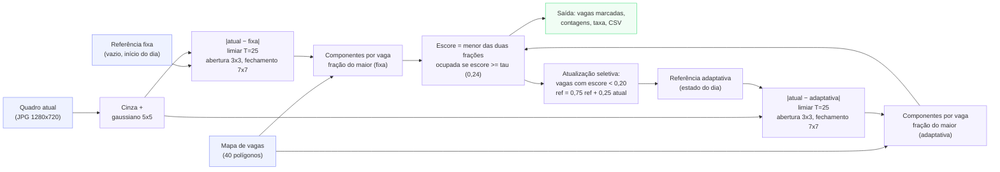

| Etapa | Papel no pipeline | Implementação |
|---|---|---|
| Pré-processamento | Cinza e gaussiano 5×5: reduz ruído do sensor e artefatos de JPEG antes da comparação pixel a pixel | `preprocess` em [`pipeline.py`](../src/parking/pipeline.py) (M2) |
| Localização das vagas | Os polígonos do XML, rasterizados como máscaras (a localização automática está fora do escopo desde a M2) | `build_regions` em [`pipeline.py`](../src/parking/pipeline.py) |
| Segmentação | Diferença absoluta contra **cada** referência, limiar global T = 25 e abertura e fechamento elípticos | `analyze` em [`pipeline.py`](../src/parking/pipeline.py) (M2) |
| Representação e descrição | Componentes conexos dentro da vaga e fração da vaga coberta pelo maior componente (`largest_frac`), mais 9 descritores; na M3, também a NCC com a referência adaptativa | `describe_space` e [`sequence.py`](../src/parking/sequence.py) |
| Decisão | **Regra:** escore = `min(largest_frac_fixa, largest_frac_adaptativa)`; ocupada se escore ≥ τ = 0,24. Alternativa avaliada: regressão logística sobre 7 descritores (E5) | [`sequence.py`](../src/parking/sequence.py), [`classifier.py`](../src/parking/classifier.py) |
| Atualização do estado | Vagas com escore < `free_max` = 0,20 misturam seus pixels à referência adaptativa com α = 0,25 | `DayProcessor.update` em [`sequence.py`](../src/parking/sequence.py) |
| Saída | Imagem com vagas verdes e vermelhas (erros em amarelo quando há rótulo); contagens; taxa; ocupação por horário | `draw_result` em [`visualize.py`](../src/parking/visualize.py), [`run_day.py`](../src/run_day.py) |

**Por que o mínimo das duas frações.** Um veículo difere de qualquer imagem da vaga vazia. Já uma mudança de iluminação costuma afetar só uma das referências:

- a fixa sofre com a deriva ao longo do dia (sol da tarde, asfalto secando);
- a adaptativa sofre quando uma sombra que ela absorveu desaparece de repente.

Exigir as duas evidências reduz os falsos positivos. O custo é que qualquer referência "cega" para um carro gera um falso negativo (seção 8).

**Exemplo** ([`painel_0715.jpg`](../images/results/m3/dia/2013-04-16/painel_0715.jpg), gerado por `python src/run_day.py --dia 2013-04-16 --quadro 07:15`):

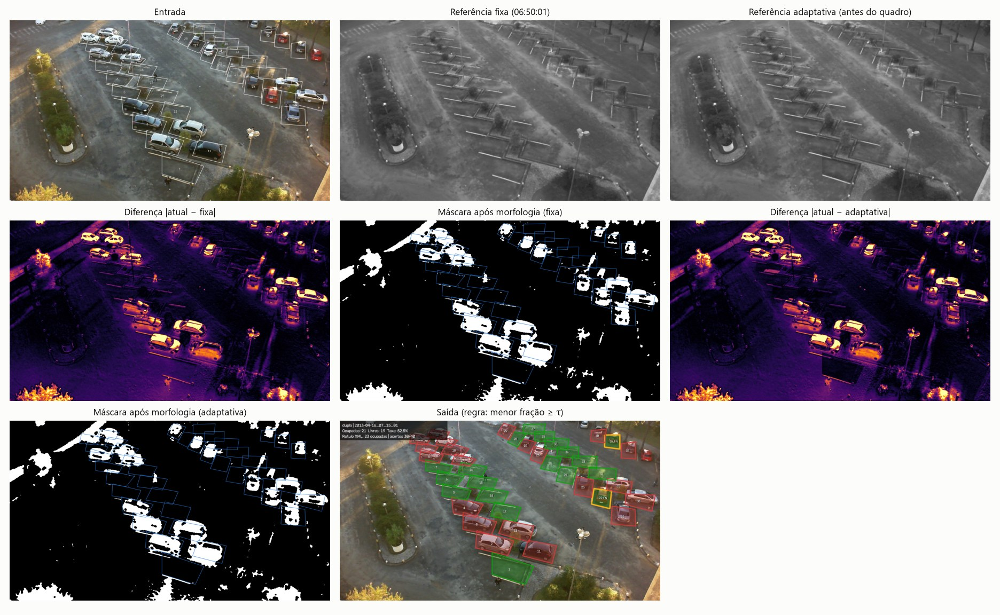

**Figura 1.** Sistema final no quadro `2013-04-16_07_15_01` (desenvolvimento, sol baixo, enchimento rápido). Aparecem as duas referências, as duas diferenças, as duas máscaras e a saída. Resultado: 21 ocupadas contra 23 rotuladas (38/40). As vagas 39 e 22 são carros escuros com pouco contraste; a M2, só com a referência fixa, errava apenas a 39.

### 4.1 Organização do código

| Arquivo | Responsabilidade |
|---|---|
| [`src/parking/dataset.py`](../src/parking/dataset.py) | XML do PKLot (polígono e rótulo) e listagem dos quadros (M2) |
| [`src/parking/pipeline.py`](../src/parking/pipeline.py) | Etapas de PDI e descritores por vaga (M2, sem alteração) |
| [`src/parking/sequence.py`](../src/parking/sequence.py) | **M3:** processamento do dia em ordem, referências fixa e adaptativa, escore e atualização seletiva |
| [`src/parking/classifier.py`](../src/parking/classifier.py) | **M3:** regressão logística L2 (IRLS), salvamento em JSON |
| [`src/parking/metrics.py`](../src/parking/metrics.py) | Matriz de confusão, indicadores, erro de contagem, AUC e varredura de limiar |
| [`src/parking/visualize.py`](../src/parking/visualize.py) | Imagens intermediárias e gráficos (figuras da M3 no fim do arquivo) |
| [`src/get_data.py`](../src/get_data.py) | **M3:** obtém os dias novos do Hugging Face e reconstrói os XMLs |
| [`src/run_final.py`](../src/run_final.py) | **M3:** etapas de desenvolvimento e teste; tabelas e figuras |
| [`src/run_day.py`](../src/run_day.py) | **M3:** sistema final em um dia (uso operacional); com `--variante`, também as outras variantes e as configurações da M2, por exemplo o baseline `B_M2` |
| [`src/explore_dev.py`](../src/explore_dev.py) | **M3:** as duas explorações que levaram a descartar ideias (ganho nas vagas livres; textura LBP), só no desenvolvimento |
| [`src/make_space_map.py`](../src/make_space_map.py) | **M3:** mapa de vagas (figura, CSV, imagem de rótulos) e figura do formato das máscaras (seção 4.2) |
| [`src/analyze_reference.py`](../src/analyze_reference.py) | **M3:** X3, sensibilidade do baseline à imagem de referência, só no desenvolvimento (seção 3.4) |
| [`src/summarize_conditions.py`](../src/summarize_conditions.py) | **M3:** indicadores do teste por condição climática, reagrupando as decisões congeladas (seção 7.2) |
| [`src/run_pipeline.py`](../src/run_pipeline.py), [`src/run_experiments.py`](../src/run_experiments.py) | Exemplo em uma imagem e experimentos da M2 (reprodutíveis, saídas idênticas) |
| [`configs/experimento_m3.json`](../configs/experimento_m3.json) | Dados, divisão, referências, grade de busca, variantes e critérios |
| [`models/sistema_final_m3.json`](../models/sistema_final_m3.json) | Parâmetros congelados, modelo logístico e sistema final escolhido |
| [`tests/`](../tests/) | 31 verificações (`python -m unittest discover -s tests`) |

**Verificações** ([`tests/`](../tests/)):

- leitura das entradas: data pelo nome do arquivo, XML com 40 vagas, vaga sem rótulo, nome fora do padrão;
- conversão do Hugging Face;
- métricas calculadas à mão;
- pipeline em cenas sintéticas: carro detectado só na sua vaga, ruído ignorado, morfologia;
- referência adaptativa absorvendo a deriva de brilho e **não** absorvendo um carro sempre visível;
- determinismo do classificador e códigos LBP conferidos à mão;
- casos de referência reais (40/40 às 10:00 de 14/04; só a vaga 39 errada às 07:15 de 16/04);
- `run_day.py` em 16/04: o baseline reproduz a M2 (2064/2079 acertos, os mesmos VP + VN da configuração B) e o sistema final dá 2061/2079, como no desenvolvimento;
- a etapa de desenvolvimento não lista os dias de teste;
- falha com mensagem para imagem inexistente e para variante inexistente.

### 4.2 Mapa de vagas e formato das máscaras

**Mapa de vagas.** As 40 vagas vêm dos polígonos dos XMLs do PKLot. Todas têm 4 vértices, em pixels da imagem 1280×720, com a origem no canto superior esquerdo. O mapa é o mesmo em toda a câmera: `make_space_map.py` confere que os 140 XMLs da amostra têm polígonos idênticos. Os ids citados neste relatório (por exemplo, as vagas 38–40 junto às árvores) são os da figura abaixo.

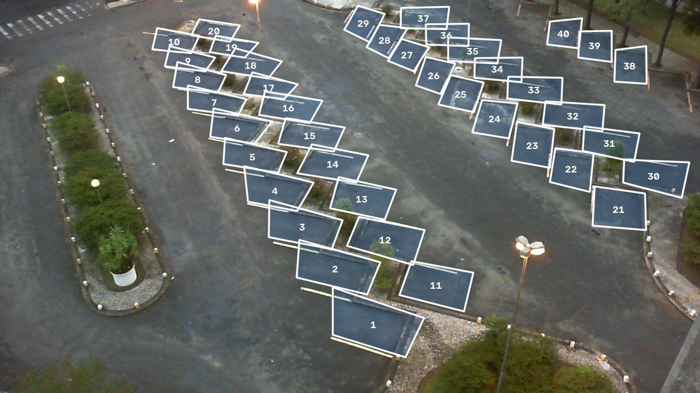

**Figura 2.** Mapa de vagas sobre a referência de 2013-04-14 06:40. Gerado por `python src/make_space_map.py`.

Arquivos do mapa, em [`images/results/m3/mapa/`](../images/results/m3/mapa/):

- [`mapa_vagas.csv`](../images/results/m3/mapa/mapa_vagas.csv): por vaga, os vértices (`x y;x y;…`), o retângulo envolvente, a área rasterizada e o centroide. As áreas vão de 2 337 px (vaga 19, no fundo da imagem) a 12 979 px (vaga 1, mais perto da câmera), com mediana de 4 248 px;
- [`mascara_vagas.png`](../images/results/m3/mapa/mascara_vagas.png): imagem de rótulos 1280×720 em `uint8`, com 0 fora das vagas e *k* nos pixels da vaga *k*.
- **Sobreposição.** Os polígonos do PKLot se sobrepõem um pouco, somando 6 225 pixels que pertencem a mais de uma vaga. O pipeline guarda uma máscara própria por vaga, então esses pixels contam nas duas. Na imagem de rótulos, que é só ilustrativa, prevalece o id maior.

**Formato das máscaras no pipeline:**

| Etapa | O que é | Tipo e valores | Tamanho |
|---|---|---|---|
| Máscara da vaga (`SpaceRegion.mask`) | Polígono rasterizado com `cv2.fillPoly` | `bool`; `True` dentro do polígono | Retângulo envolvente da vaga |
| Diferença | \|atual − referência\| após cinza e gaussiano | `uint8`, 0–255 | Quadro inteiro (1280×720) |
| Limiarizada | Diferença > T (T = 25) | `uint8`, só 0 ou 255 | Quadro inteiro |
| Abertura e fechamento | Disco de 3 px e depois de 7 px (`MORPH_ELLIPSE`) | `uint8`, só 0 ou 255 | Quadro inteiro |
| Componentes | Rotulagem com vizinhança 8 de (máscara após o fechamento ∧ máscara da vaga) | `int32`, 0 = fundo, *k* = componente | Retângulo envolvente da vaga |
| Escore | Área do maior componente / área da vaga (`largest_frac`) | `float`, 0–1; ocupada se ≥ τ | Um valor por vaga |

Em `run_pipeline.py`, as máscaras (`05_limiarizada` a `08_componentes`) são gravadas em PNG, sem perdas. Os componentes vão coloridos, com o escore escrito em cada vaga. As fotos vão em JPEG.

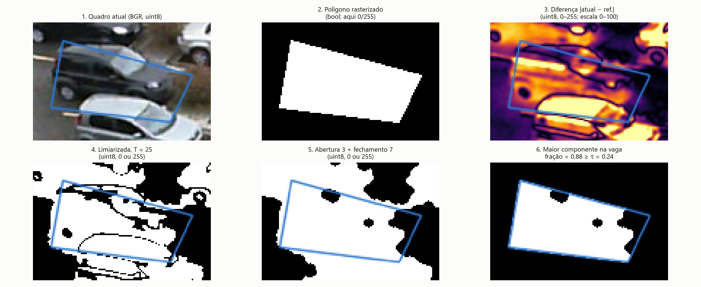

**Figura 3.** Vaga 8 no quadro `2013-04-14_10_00_04` (configuração B, referência de 06:40): da imagem ao maior componente. O contorno azul é o polígono da vaga. O maior componente cobre 0,88 da vaga, acima de τ = 0,24, e a vaga é classificada como ocupada (correto).

---

## 5. Justificativa das decisões e parâmetros

### 5.1 Por que tratar a iluminação ao longo do dia

O primeiro passo da M3 foi estender o desenvolvimento para a tarde. Mesmo com τ reajustado para 0,43 em todo o desenvolvimento, a referência fixa errou muito nas tardes ([`metricas_desenvolvimento.csv`](../images/results/m3/desenvolvimento/metricas_desenvolvimento.csv)):

| Segmento do desenvolvimento | FP (fixa) | Especificidade (fixa) | FP (dupla) | Especificidade (dupla) |
|---|---:|---:|---:|---:|
| 2013-04-13, nublado, 09:20–18:05 | 293 | 0,910 | 1 | 1,000 |
| 2013-04-14, sol, 11:20–18:05 | 232 | 0,821 | 19 | 0,985 |

Nesses dias de pouca ocupação, a maioria das vagas fica livre à tarde. O asfalto da tarde fica mais claro que a referência da manhã quando há sol e mais escuro depois que o asfalto molhado da madrugada seca. Assim, a diferença passa de T em vagas vazias.

### 5.2 Referência adaptativa e por que manter a fixa

A referência adaptativa acompanha a deriva. Mas o desenvolvimento mostrou um modo de falha: ela absorve as sombras longas do fim da tarde e, quando o sol some (≈17:00 em 14/04), as vagas livres passam a diferir dela. Como só vagas livres são atualizadas, a vaga trava como ocupada até o fim do dia.

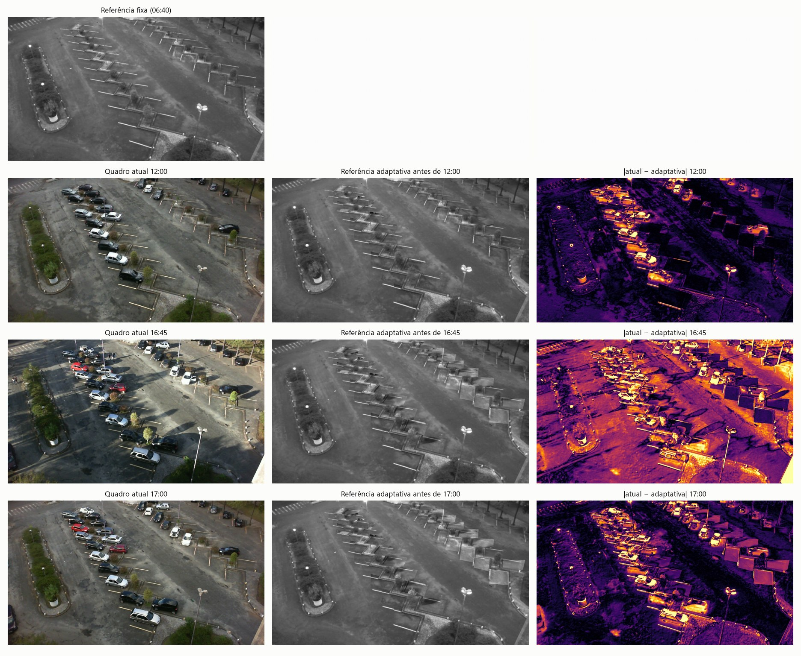

**Figura 4.** Desenvolvimento, 14/04. Às 12:00 a diferença contra a referência adaptativa destaca só os carros. Às 16:45 a referência adaptativa já carrega sombras e a diferença fica alta em todo o pátio sob sol baixo. Às 17:00, sem sol, as vagas atualizadas com sombra aparecem como retângulos claros na diferença.

Manter a referência fixa ao lado e exigir as duas evidências (o mínimo) libera essas vagas, porque depois do pôr do sol a luz difusa volta a parecer a da manhã. Na validação cruzada, o F1 foi de 0,976 com só a adaptativa e de 0,987 com a dupla (tabela 5.5).

Também testamos a compensação de ganho estimada só nas vagas livres, como sugeria a M2 (item M3-2a). Antes de cada quadro, a referência adaptativa é multiplicada por g = mediana(quadro) / mediana(referência), as duas medidas nos pixels das vagas julgadas livres no quadro anterior. Em 16/04 o ganho variou de 0,60 a 1,55 entre quadros. Aplicado repetidamente, ele desloca a referência durante o enchimento da manhã, e os falsos negativos explodem. A ideia foi descartada ([`resultados_exploracao.md`](../images/results/m3/exploracao/resultados_exploracao.md), X1):

| 2013-04-16 (desenvolvimento) | FN | F1 | EMA contagem |
|---|---:|---:|---:|
| adaptativa | 12 | 0,995 | 0,33 |
| adaptativa + ganho | 593 | 0,793 | 11,15 |
| dupla | 12 | 0,995 | 0,35 |
| dupla + ganho | 493 | 0,835 | 9,39 |

A exploração original foi feita antes do congelamento, com parâmetros provisórios e scripts fora do repositório. [`src/explore_dev.py`](../src/explore_dev.py) a refaz com o código versionado, só no desenvolvimento e com os parâmetros congelados. Os números mudam, mas a conclusão é a mesma.

### 5.3 Parâmetros

| Parâmetro | Valor | Como foi escolhido |
|---|---|---|
| Gaussiano, T, abertura, fechamento, área mínima | 5×5, 25, 3×3, 7×7, 15 px | Mantidos da configuração B da M2 (ajustados lá) |
| α (taxa da média móvel) | 0,25 | Grade {0,05; 0,1; 0,25; 0,5} no desenvolvimento |
| `free_max` (folga para atualizar) | 0,20 | Grade {0,10; …; 0,30}, com restrição τ ≥ `free_max` para que uma vaga considerada ocupada nunca atualize a referência |
| τ (limiar do escore) | 0,24 | Varredura 0,01–0,99 para cada par (α, `free_max`) |

A primeira grade (α 0,1–1,0; `free_max` 0,05–0,20) teve o ótimo **na borda** (`free_max` = 0,20). Por isso, foi ampliada antes de qualquer contato com o teste ([`grade_ajuste_inicial.csv`](../images/results/m3/desenvolvimento/grade_ajuste_inicial.csv); commit `9a56cdf`). Na grade final, o ótimo ficou no interior:

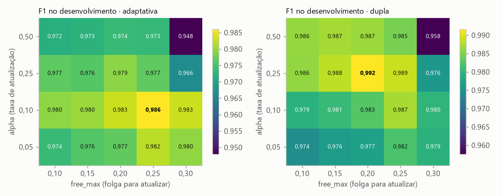

**Figura 5.** F1 no desenvolvimento para cada par (α, `free_max`), com τ ótimo em cada célula; o valor escolhido está em negrito. α = 0,5 com `free_max` = 0,30 é o pior caso: atualizar rápido e com folga grande incorpora carros ao fundo. Esse foi o mesmo mecanismo que apareceu no teste (seção 8).

### 5.4 Classificador

A regressão logística usa 7 descritores: a fração do maior componente e a média da diferença contra as duas referências, a NCC com a adaptativa, o desvio padrão do cinza e a densidade de bordas. Usa λ = 1, e o limiar de probabilidade (0,54) foi ajustado por F1 no próprio treino.

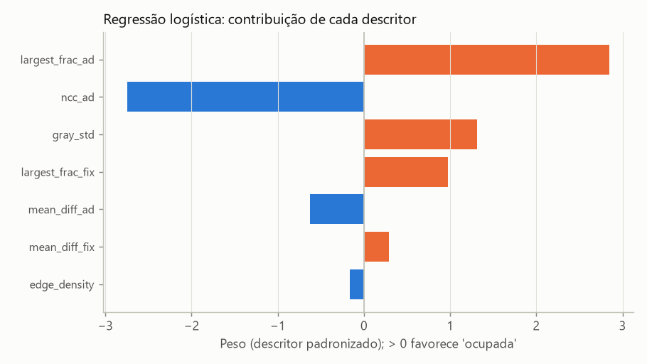

**Figura 6.** Pesos sobre descritores padronizados. Dominam a fração do maior componente contra a adaptativa (+2,84) e a NCC com a adaptativa (−2,75: estrutura diferente da referência indica carro). Os descritores sem referência pesam pouco (desvio do cinza +1,32; densidade de bordas −0,16).

Também testamos classificar só pela textura, sem referência, como no artigo do PKLot. Os descritores foram o histograma LBP uniforme invariante à rotação (8 vizinhos, raio 1), o desvio do cinza, a densidade de bordas e o croma médio do quadro. A comparação usa a mesma regressão logística e a mesma validação cruzada por dia ([`resultados_exploracao.md`](../images/results/m3/exploracao/resultados_exploracao.md), X2):

| Descritores | FP | FN | F1 (validação por dia) |
|---|---:|---:|---:|
| textura (sem referência) | 380 | 383 | 0,924 |
| diferença (os 7 da regressão logística acima) | 52 | 109 | 0,984 |
| textura + diferença | 199 | 109 | 0,970 |

A textura sozinha ficou bem abaixo, e acrescentá-la à diferença piorou o resultado. Uma explicação provável é que três dias de treino são poucos para um classificador sem referência generalizar. Por isso, não a adotamos.

### 5.5 Validação cruzada e escolha do sistema final

Dados de [`validacao_cruzada.csv`](../images/results/m3/desenvolvimento/validacao_cruzada.csv): fora da amostra, com cada dia avaliado por parâmetros ajustados nos outros dois.

| Variante | FP | FN | F1 | Especificidade |
|---|---:|---:|---:|---:|
| fixa (τ reajustado) | 599 | 248 | 0,919 | 0,924 |
| adaptativa | 190 | 57 | 0,976 | 0,976 |
| **dupla (regra)** | **70** | **60** | **0,987** | **0,991** |
| dupla + regressão logística | 89 | 110 | 0,980 | 0,989 |

Pela regra declarada, o sistema final é a **dupla com decisão por regra**. A regressão logística ficou abaixo da regra e foi mantida só como ablação (E5).

---

## 6. Baseline, comparações e procedimento experimental

**Baseline.** A configuração **B da M2 congelada** (`B_M2`): referência fixa, T = 25, abertura 3×3, fechamento 7×7, τ = 0,24 ajustado no dia nublado da M2. Não foi reajustada.

**Configurações avaliadas no teste** (mesmas vaga-quadros, referências e rótulos):

| Nome | O que muda | Parâmetros |
|---|---|---|
| `B_M2` | Baseline (M2) | τ = 0,24 |
| `A_M2`, `C_M2` | Reavaliação das configurações A (sem morfologia) e C (ganho global) da M2 | os da M2 |
| `fixa` | Só referência fixa, τ reajustado no desenvolvimento da M3 | τ = 0,43 |
| `adaptativa` | Só referência adaptativa | α = 0,10, `free_max` = 0,25, τ = 0,29 |
| **`dupla`** | **Sistema final:** fixa + adaptativa, regra do mínimo | α = 0,25, `free_max` = 0,20, τ = 0,24 |
| `dupla_LR` | Referências da dupla; decisão por regressão logística | limiar 0,54 |

**Comparações** e o que cada uma isola:

| Id | Pergunta | Base → variante | O que muda |
|---|---|---|---|
| Baseline × final | O sistema final supera o baseline? | `B_M2` → `dupla` | Sistema (referência adaptativa + regra do mínimo + reajuste de τ); compara sistemas, não um componente |
| E3 | A referência adaptativa reduz os erros da deriva? | `fixa` → `adaptativa` | Troca da referência; τ, α e `free_max` reajustados pelo mesmo procedimento |
| E4 | Manter a fixa ao lado da adaptativa evita os travamentos? | `adaptativa` → `dupla` | Acrescenta a referência fixa (cada variante no seu ótimo de ajuste; α e `free_max` diferem) |
| E5 | A regressão logística supera a regra? | `dupla` → `dupla_LR` | **Só a decisão:** mesmas referências e o mesmo estado adaptativo |
| E1, E2 (reavaliação) | As conclusões da M2 valem em dias inéditos? | `A_M2` → `B_M2`; `B_M2` → `C_M2` | Só a morfologia; só o ganho global |

Como na M2, cada variante é comparada no seu próprio ponto ótimo de ajuste. E3 e E4 comparam métodos ajustados pelo mesmo procedimento, não um único parâmetro. E5, E1 e E2 isolam uma decisão.

---

## 7. Resultados

### 7.1 Tabela consolidada (teste, 4 dias inéditos, 23 019 vaga-quadros)

Dados de [`metricas.csv`](../images/results/m3/teste/metricas.csv) e [`resultados.md`](../images/results/m3/teste/resultados.md).

| Configuração | VP | FP | FN | VN | Precisão | Revocação | Especificidade | F1 | Acur. balanceada | EMA contagem | Erro máx. |
|---|---:|---:|---:|---:|---:|---:|---:|---:|---:|---:|---:|
| **`B_M2` (baseline)** | 20 273 | 169 | **259** | 2 318 | 0,992 | **0,987** | 0,932 | **0,990** | 0,960 | **0,66** | 7 |
| `A_M2` | 20 095 | 207 | 437 | 2 280 | 0,990 | 0,979 | 0,917 | 0,984 | 0,948 | 0,97 | 7 |
| `C_M2` | 20 107 | 119 | 425 | 2 368 | 0,994 | 0,979 | 0,952 | 0,987 | **0,966** | 0,85 | 6 |
| `fixa` | 19 372 | 66 | 1 160 | 2 421 | 0,997 | 0,944 | 0,974 | 0,969 | 0,959 | 2,04 | 8 |
| `adaptativa` | 19 648 | 80 | 884 | 2 407 | 0,996 | 0,957 | 0,968 | 0,976 | 0,962 | 1,53 | 5 |
| **`dupla` (final)** | 19 546 | **58** | 986 | 2 429 | **0,997** | 0,952 | **0,977** | 0,974 | 0,964 | 1,74 | 6 |
| `dupla_LR` | 19 546 | 105 | 986 | 2 382 | 0,995 | 0,952 | 0,958 | 0,973 | 0,955 | 1,71 | 6 |

EMA = erro absoluto médio do nº de vagas ocupadas por imagem (576 imagens).

### 7.2 Por dia, por condição e critérios de sucesso

| Dia | F1 `B_M2` | F1 `dupla` | EMA `B_M2` | EMA `dupla` |
|---|---:|---:|---:|---:|
| 2013-03-13 (qua., com chuva à tarde) | 0,988 | 0,980 | 0,78 | 1,34 |
| 2013-03-14 (qui., nublado) | 0,988 | 0,956 | 0,75 | 2,93 |
| 2013-03-19 (ter., chuva de manhã) | 0,994 | 0,980 | 0,40 | 1,36 |
| 2013-03-21 (qui., sol) | 0,988 | 0,980 | 0,68 | 1,30 |

**Por condição climática.** Os dados vêm de [`resultados_por_condicao.md`](../images/results/m3/teste/resultados_por_condicao.md) e [`por_condicao.csv`](../images/results/m3/teste/por_condicao.csv), gerados por `src/summarize_conditions.py`. O script reagrupa as decisões congeladas de `decisoes.csv`, sem rodar o pipeline de novo, e confere os totais contra `metricas.csv`. A condição é o rótulo do PKLot para cada quadro: sol tem 158 quadros, nublado 356 e chuva 62. O arquivo traz as 7 configurações; abaixo estão o baseline, a configuração com ganho e o sistema final.

| Configuração | Condição | Vagas livres avaliadas | FP | FN | F1 | Especificidade | Taxa falsa ocupada | Taxa falsa livre | EMA |
|---|---|---:|---:|---:|---:|---:|---:|---:|---:|
| `B_M2` | sol | 870 | 76 | 53 | 0,988 | 0,913 | 0,087 | 0,010 | 0,66 |
| `B_M2` | nublado | 1 247 | 88 | 112 | 0,992 | 0,929 | 0,071 | 0,009 | 0,51 |
| `B_M2` | chuva | 370 | 5 | 94 | 0,976 | 0,986 | 0,014 | 0,045 | 1,47 |
| `C_M2` | sol | 870 | 86 | 56 | 0,987 | 0,901 | 0,099 | 0,010 | 0,76 |
| `C_M2` | nublado | 1 247 | 31 | 244 | 0,989 | 0,975 | 0,025 | 0,019 | 0,69 |
| `C_M2` | chuva | 370 | 2 | 125 | 0,969 | 0,995 | 0,005 | 0,060 | 2,02 |
| `dupla` | sol | 870 | 38 | 166 | 0,981 | 0,956 | 0,044 | 0,030 | 1,23 |
| `dupla` | nublado | 1 247 | 18 | 675 | 0,973 | 0,986 | 0,014 | 0,052 | 1,87 |
| `dupla` | chuva | 370 | 2 | 145 | 0,964 | 0,995 | 0,005 | 0,069 | 2,31 |

- **O sol produz as falsas vagas ocupadas do baseline.** Quase 9% das vagas livres ao sol aparecem como ocupadas, por causa das sombras e do asfalto iluminado (Figura 10).
- **A chuva produz as falsas vagas livres.** A taxa de falsa vaga livre do `B_M2` na chuva é 4,5 vezes a do sol (0,045 contra 0,010), e o EMA vai de 0,51 a 0,66 (nublado e sol) para 1,47. Uma explicação provável, não verificada caso a caso, é o contraste menor entre carros molhados e o asfalto escuro.
- **Em todas as condições, a `dupla` troca FP por FN.** Ela reduz a falsa vaga ocupada e aumenta a falsa vaga livre. O aumento maior está no nublado (FN 112 → 675), onde estão os dias inteiros com absorção (seção 8.1).
- **A amostra de chuva é pequena:** 62 quadros e só 370 vagas livres. Uma especificidade de 0,986 contra 0,995 é a diferença entre 5 e 2 FP.

| Critério (M2) | `dupla` (sistema final) | `B_M2` (baseline) |
|---|---|---|
| F1 ≥ 0,95 em cada dia | atendido (mínimo 0,956) | atendido (mínimo 0,988) |
| Especificidade ≥ 0,98 na chuva | atendido (0,995) | atendido (0,986) |
| EMA ≤ 1 vaga por imagem | **não atendido** (1,30 a 2,93) | atendido (0,40 a 0,78) |

### 7.3 Comparações

Dados de [`comparacoes.csv`](../images/results/m3/teste/comparacoes.csv). "Corrigidos" e "introduzidos" contam vaga-quadros que a variante acerta e a base erra, e vice-versa.

| Id | Base → variante | F1 | FP | FN | EMA | Corrigidos | Introduzidos |
|---|---|---|---|---|---|---:|---:|
| Baseline × final | `B_M2` → `dupla` | 0,990 → 0,974 | 169 → 58 | 259 → 986 | 0,66 → 1,74 | 111 | 727 |
| E3 | `fixa` → `adaptativa` | 0,969 → 0,976 | 66 → 80 | 1 160 → 884 | 2,04 → 1,53 | 546 | 284 |
| E4 | `adaptativa` → `dupla` | 0,976 → 0,974 | 80 → 58 | 884 → 986 | 1,53 → 1,74 | 116 | 196 |
| E5 | `dupla` → `dupla_LR` | 0,974 → 0,973 | 58 → 105 | 986 → 986 | 1,74 → 1,71 | 52 | 99 |
| E1 (reavaliação) | `A_M2` → `B_M2` | 0,984 → 0,990 | 207 → 169 | 437 → 259 | 0,97 → 0,66 | 284 | 68 |
| E2 (reavaliação) | `B_M2` → `C_M2` | 0,990 → 0,987 | 169 → 119 | 259 → 425 | 0,66 → 0,85 | 155 | 271 |

**Respostas:**

- **Baseline × final: não.** O sistema final cumpre o que foi desenhado para fazer nos falsos positivos (169 → 58; especificidade de 0,932 para 0,977). Mas introduz 727 falsos negativos e piora o F1 e a contagem. A acurácia balanceada fica praticamente igual (0,960 → 0,964): o ganho na classe livre compensa a perda na ocupada só quando as duas classes pesam o mesmo. Com 89% de vagas ocupadas, F1 e EMA são dominados pelos falsos negativos.
- **E3: sim, em parte.** Contra a referência fixa *reajustada no desenvolvimento* (τ = 0,43), a adaptativa reduz os FN de 1 160 para 884. Porém a `fixa` com τ = 0,43 é pior que o próprio `B_M2` (τ = 0,24). O reajuste em tardes de pouca ocupação subiu τ demais para dias lotados (seção 8).
- **E4: não no teste.** A referência fixa reduz os FP (80 → 58), como no desenvolvimento, mas o efeito líquido é negativo (116 corrigidos, 196 introduzidos).
- **E5: não.** Com as mesmas referências, a regressão logística tem os mesmos 986 FN e quase o dobro de FP. O erro dominante está no estado da referência, que nenhuma regra de decisão sobre esses descritores consegue desfazer.
- **E1 (reavaliação): a conclusão da M2 se mantém.** A morfologia corrige 284 erros e introduz 68.
- **E2 (reavaliação): a conclusão da M2 se mantém.** A compensação global de ganho reduz FP e aumenta FN, e o saldo é negativo, como na M2. A separação por clima está em 7.3.1.

#### 7.3.1 Experimento recomendado no parecer: diferença simples × diferença com compensação de ganho, sob chuva e sol

O parecer da M2 recomendou este experimento final. Ele é a E2 da tabela acima, separada por condição:

- `B_M2` é a diferença simples;
- `C_M2` é a mesma diferença com o quadro multiplicado por g = mediana(referência) / mediana(quadro);
- as duas foram congeladas na M2, com o mesmo τ = 0,24, e não foram reajustadas no teste;
- as imagens, as referências e os rótulos são os mesmos nas duas.

Dados de [`resultados_por_condicao.md`](../images/results/m3/teste/resultados_por_condicao.md):

| Condição | F1 | Taxa falsa ocupada | Taxa falsa livre | FP | FN | EMA | Corrigidos | Introduzidos |
|---|---|---|---|---|---|---|---:|---:|
| sol | 0,988 → 0,987 | 0,087 → 0,099 | 0,010 → 0,010 | 76 → 86 | 53 → 56 | 0,66 → 0,76 | 31 | 44 |
| chuva | 0,976 → 0,969 | 0,014 → 0,005 | 0,045 → 0,060 | 5 → 2 | 94 → 125 | 1,47 → 2,02 | 9 | 37 |
| nublado | 0,992 → 0,989 | 0,071 → 0,025 | 0,009 → 0,019 | 88 → 31 | 112 → 244 | 0,51 → 0,69 | 115 | 190 |
| total | 0,990 → 0,987 | 0,068 → 0,048 | 0,013 → 0,021 | 169 → 119 | 259 → 425 | 0,66 → 0,85 | 155 | 271 |

- **Sol: a compensação piora os dois tipos de erro** (FP 76 → 86, FN 53 → 56). Os FP do sol vêm de sombras e manchas de luz **locais**, e um ganho único para o quadro inteiro não as corrige.
- **Chuva: o ganho troca 3 FP por 31 FN**, e o EMA sobe de 1,47 para 2,02. Não verificamos quadro a quadro em que direção o ganho atuou na chuva.
- **Nublado:** é a única condição com redução grande de FP (88 → 31), mas os FN mais que dobram (112 → 244).
- **Em nenhuma condição o saldo é positivo.** Nas três, os erros introduzidos superam os corrigidos.

A explicação da M2 é compatível com isso. A mediana do quadro inteiro depende de quantos carros há na cena, e com 89% das vagas ocupadas ela passa a medir os carros, não a luz. A conclusão da M2, de não adotar a configuração C, vale nos dias inéditos e nas três condições. Por isso, as compensações de iluminação testadas na M3 foram locais, não globais: o ganho medido só nas vagas livres e a referência adaptativa (seção 5.2).

### 7.4 Resultados ao longo do dia

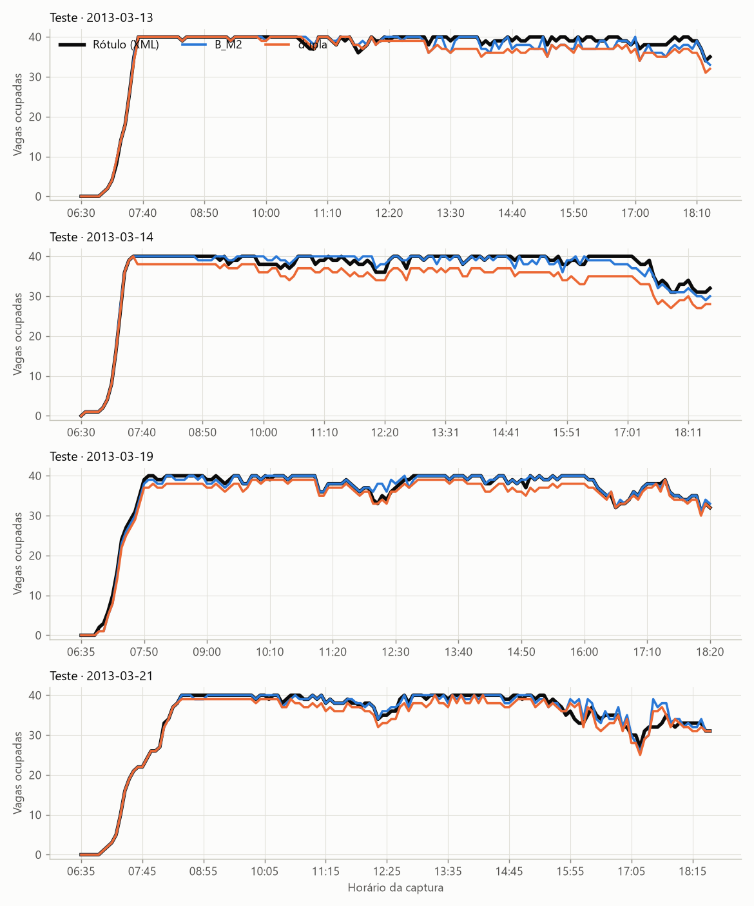

**Figura 7.** Vagas ocupadas por quadro: rótulo (preto), baseline (azul) e sistema final (laranja). Os dois sistemas acompanham o enchimento das 06:50–07:40. A partir daí, o final fica sistematicamente abaixo do rótulo. Em 14/03, a partir das 07:35, ele fica 2 ou mais vagas abaixo do rótulo em 130 dos 133 quadros (nos outros 3, 1 vaga abaixo): são carros absorvidos durante o enchimento (vagas 38 e 40, tabela 8.1). O baseline oscila mais no fim da tarde de 21/03 (sol baixo; até +7 vagas às 17:30).

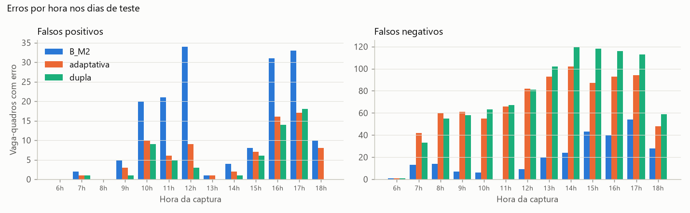

**Figura 8.** Erros por hora nos dias de teste.

- **Falsos positivos:** os do baseline se concentram nas horas de sol forte (10h–12h) e de sol baixo (16h–17h), e as referências adaptativas os reduzem.
- **Falsos negativos:** os das variantes adaptativas **crescem ao longo do dia**, de cerca de 30–60 por hora pela manhã para mais de 100 por hora à tarde. É o padrão esperado de um erro que, uma vez instalado, se acumula.

### 7.5 Exemplos de sucesso e falha do sistema final

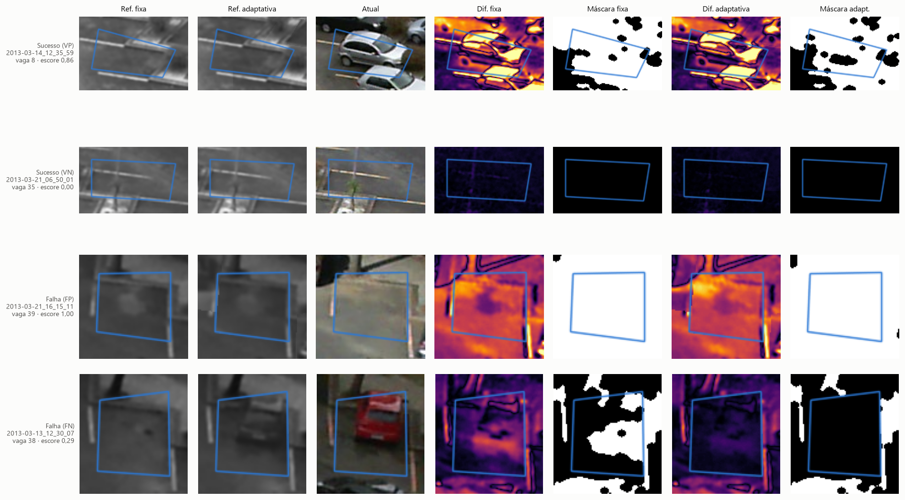

**Figura 9.** Recortes da vaga: referência fixa, referência adaptativa (estado no momento do quadro), quadro atual, diferença e máscara contra cada referência.

- **VP** (`2013-03-14_12_35_59`, vaga 8): o carro aparece nas duas máscaras.
- **VN** (`2013-03-21_06_50_01`, vaga 35): as duas diferenças são quase nulas.
- **FP** (`2013-03-21_16_15_11`, vaga 39, escore 1,00): sol baixo sobre a vaga vazia ao lado das árvores. As **duas** referências diferem do asfalto iluminado, e a regra do mínimo não ajuda quando ambas falham.
- **FN** (`2013-03-13_12_30_07`, vaga 38, chuva): o carro vermelho é visível na máscara contra a referência fixa. Mas a **referência adaptativa contém um "fantasma" do próprio carro**, e a máscara contra ela fica vazia. É a absorção descrita na seção 8.

| Pior quadro do baseline: `2013-03-21_17_30_13` (7 erros; final: 4) | Pior quadro do sistema final: `2013-03-14_17_26_05` (6 erros; baseline: 4) |
|---|---|
| 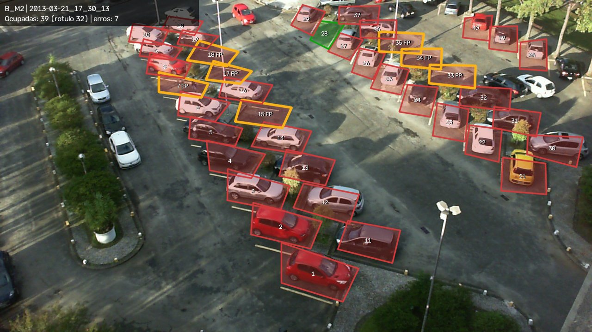 | 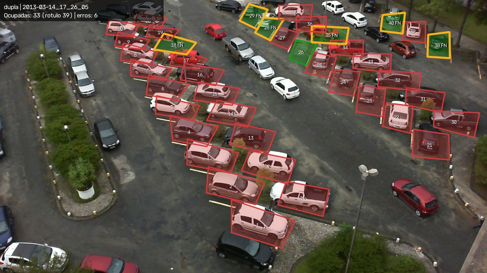 |

**Figura 10.**

- **Esquerda:** os 7 FP do baseline às 17:30 de 21/03 são vagas livres cruzadas por sombras longas de árvores e do prédio, um erro de iluminação. No mesmo quadro, o sistema final erra 4.
- **Direita:** os 6 FN do sistema final às 17:26 de 14/03 (dia nublado) incluem as vagas 38 e 40, junto às árvores, que estão FN desde a manhã (tabela 8.1).

---

## 8. Análise de erros, limitações e ameaças à validade

### 8.1 Por que o sistema final perdeu para o baseline

Dados de [`falsos_negativos_dupla.csv`](../images/results/m3/teste/falsos_negativos_dupla.csv) e de [`resultados.md`](../images/results/m3/teste/resultados.md), seção "Falsos negativos". Para cada falso negativo da `dupla`, verificamos qual referência ainda "via" o carro, isto é, tinha fração ≥ τ:

| Situação do falso negativo | Vaga-quadros | Fração |
|---|---:|---:|
| Só a referência fixa vê o carro: **absorvido pela adaptativa** | 727 | 73,7% |
| Nenhuma referência vê o carro (baixo contraste) | 253 | 25,7% |
| Só a adaptativa vê o carro | 6 | 0,6% |

**876 dos 986 falsos negativos** estão em sequências de 12 ou mais quadros seguidos (≥ 1 h) na mesma vaga. Maiores sequências:

| Dia | Vaga | Início | Quadros seguidos |
|---|---:|---|---:|
| 2013-03-14 | 38 | 07:35 | 133 (≈ 11 h) |
| 2013-03-19 | 39 | 07:20 | 107 |
| 2013-03-14 | 28 | 10:20 | 98 |
| 2013-03-13 | 38 | 12:15 | 75 |
| 2013-03-14 | 40 | 12:25 | 75 |

**Mecanismo (realimentação positiva).** Um carro chega e, em algum quadro, tem escore abaixo de `free_max` = 0,20. Isso acontece, por exemplo, enquanto ainda está manobrando, ou quando tem pouco contraste com o asfalto (carros escuros ou vermelhos junto às árvores, vagas 38–40). Então:

1. a vaga é atualizada e o carro entra 25% na referência adaptativa;
2. no quadro seguinte, a diferença contra a adaptativa é menor, e a vaga volta a ser atualizada;
3. em poucos quadros o carro faz parte do "fundo";
4. a regra do mínimo passa a classificar a vaga como livre enquanto o carro ficar ali.

Os **727 erros introduzidos** em relação ao baseline são exatamente esses 727 FN, e não por coincidência. A fração contra a referência fixa é o próprio escore do baseline, e a regra do mínimo só pode errar onde o baseline acerta quando a referência adaptativa "perde" o carro. Pelo mesmo motivo, a dupla não introduz nenhum falso positivo em relação ao baseline.

**Por que o desenvolvimento não mostrou isso:**

1. **Regime de ocupação.** O desenvolvimento tinha 38,9% de vagas ocupadas (sábado, domingo e uma manhã de terça). O teste tem 89,2% (quatro dias úteis lotados). Com poucas chegadas, há poucas oportunidades de absorção e muitas vagas livres expostas à deriva de iluminação. Por isso, o desenvolvimento premiou a redução de FP. No teste, o peso inverte.
2. **Critério de ajuste.** O F1 com a prevalência do desenvolvimento levou a escolhas que reduzem FP. A `fixa` com τ reajustado para 0,43 mostra o mesmo efeito: foi a pior no teste em FN (1 160).
3. **Poucos dias de desenvolvimento.** A validação cruzada com três dias não tinha nenhum dia útil inteiro para revelar o problema.

**O baseline também erra, mas de outra forma.** Seus 169 FP vêm de sol forte e sombras longas (Figura 10, à esquerda). Seus 259 FN são, como os 253 "invisíveis" da dupla, carros de baixo contraste: as vagas 38 e 39, a mesma falha da M2. Em dias úteis cheios há poucas vagas livres para os FP aparecerem, e por isso a referência fixa funciona bem nesse regime.

### 8.2 Outras falhas observadas

| Falha | Exemplo | Causa | Afeta |
|---|---|---|---|
| FP com sol baixo e sombras longas | `2013-03-21_17_30_13`, vagas 7, 15, 17, 18, 33–35 | A referência do amanhecer não tem sombras projetadas | Baseline; reduzido, mas não eliminado, no final |
| FP com sol direto na vaga vazia | `2013-03-21_16_15_11`, vaga 39 | As duas referências diferem do asfalto iluminado | Todas as variantes |
| FN de carros de baixo contraste | vagas 38–40 (árvores), carros escuros ou vermelhos | A conversão para cinza descarta a cor; a sombra das árvores aproxima a luminância do carro da do asfalto | Todas (≈ 250 FN) |
| FN persistente por absorção | vagas 38, 39, 28, 40 | Realimentação da atualização seletiva (8.1) | Variantes adaptativas |

### 8.3 Limitações e ameaças à validade

- **Uma câmera, um estacionamento, sete dias no total**, sempre em horário diurno. Não há evidência para outras câmeras, para a noite ou para outras épocas do ano.
- **Quadros correlacionados.** Os quadros têm 5 min de intervalo, e um único carro parado gera dezenas de erros seguidos. A vaga 38 em 14/03 sozinha responde por 13% dos FN da dupla. Diferenças de algumas dezenas de erros entre variantes não são conclusivas. As grandes diferenças (FN 259 contra 986) se repetem nos quatro dias.
- **Seleção dos dias de teste.** Para aplicar as regras da seção 3.2, consultamos estatísticas dos rótulos de todos os dias do UFPR05: faixa de ocupação, horários e existência de um quadro vazio. Nenhum resultado do sistema foi consultado. Dias sem quadro vazio, como 15/03 e 20/03, ficaram de fora, o que favorece a hipótese operacional do sistema (o custo dessa exigência está na seção 3.4).
- **Desbalanceamento.** O teste tem 89% de vagas ocupadas. A especificidade se apoia em 2 487 vaga-quadros livres, e a dos quadros de chuva em 370.
- **Referência de avaliação.** Os rótulos do PKLot não foram auditados. Os casos inspecionados visualmente não mostraram erro de rótulo.
- **Explorações refeitas depois do congelamento.** As decisões de descartar o ganho nas vagas livres e a textura LBP foram tomadas com explorações feitas fora do repositório. `explore_dev.py` as reproduz depois, só com dados de desenvolvimento. A evidência é rastreável, mas os números versionados não são os que estavam na mesa no momento da decisão.
- **Conclusão a posteriori.** A afirmação de que o baseline é preferível em dias úteis vem do próprio teste. Para confirmá-la, seriam necessários dias novos.

---

## 9. Atendimento aos objetivos, conclusão e melhorias futuras

**Objetivos da proposta:**

| Objetivo específico | Situação |
|---|---|
| Selecionar e organizar um conjunto de imagens | Atendido: amostra versionada, 767 imagens novas obtidas por script com revisão e SHA-256 fixados, manifestos |
| Investigar pré-processamento | Atendido na M2 (cinza + gaussiano; ganho global testado e rejeitado, conclusão reconfirmada em E2) |
| Investigar técnicas para o estado de cada vaga | Atendido: diferença, limiar, morfologia, componentes; referência adaptativa na M3 |
| Estratégia de classificação | Atendido: regra de limiar e regressão logística, comparadas (E5) |
| Avaliar com métricas contra os rótulos | Atendido: protocolo em duas etapas, teste em dias inéditos, baseline, 6 comparações, análise de erros |
| Informações de ocupação (livres, ocupadas, taxa) | Atendido: `run_day.py` (por horário, com o sistema final ou o baseline) e `run_pipeline.py` (por imagem) |

**Critérios de sucesso.** O sistema final declarado (`dupla`) atendeu ao F1 por dia e à especificidade na chuva, mas **não** ao erro de contagem (1,30 a 2,93 vaga por imagem). O baseline da M2 atendeu aos três nos dias de teste.

**Conclusão.** Respondendo à questão investigada: com uma referência do estacionamento vazio por dia, técnicas clássicas classificaram a ocupação de dias úteis inteiros com F1 de 0,990 e erro médio de 0,66 vaga por imagem em dias inéditos. Isso vale para a configuração B da M2, mantida sem alteração. A tentativa da M3 de tornar a referência adaptativa resolveu o problema que motivou a mudança: os falsos positivos de iluminação, que eram dominantes nas tardes de baixa ocupação do desenvolvimento. Mas ela criou um problema pior para dias lotados, a incorporação de carros parados à referência. A principal lição é de protocolo: o conjunto de desenvolvimento precisa representar o regime de uso (dias úteis, alta ocupação). Validação cruzada sobre três dias atípicos escolheu com confiança a variante errada.

**Melhorias futuras** (hipóteses para testar em dias novos, não testadas aqui):

1. **Impedir a absorção:** atualizar a vaga só quando **as duas** referências a veem livre (máximo das frações < `free_max`, em vez do mínimo); ou exigir vários quadros seguidos livres antes de atualizar.
2. **Escolher a regra pela ocupação esperada:** referência fixa em horários e dias de lotação alta, adaptativa quando há muitas vagas livres. Isso exige um desenvolvimento com dias úteis.
3. **Critério de ajuste alinhado ao uso:** minimizar o EMA de contagem ou a acurácia balanceada por dia, em vez do F1 agregado.
4. **Cor contra o baixo contraste** (plano M3-1 da M2, não executado): diferença em croma (Lab) para os carros vermelhos e escuros das vagas 38–40.
5. **Mais dias de desenvolvimento**, incluindo dias úteis inteiros, e avaliação em outro estacionamento do PKLot (UFPR04, PUCPR).

---

## 10. Evolução M1 → M2 → M3 e tratamento do feedback

| Etapa | O que foi feito | Onde ver |
|---|---|---|
| **M1** (ago/2026) | Problema, contexto, proposta de pipeline (pré-processamento, separação das vagas por Hough, diferença, limiar, morfologia), escolha do PKLot | [`proposta.md`](proposta.md), vídeo da M1, commits de 30/08 a 01/09 |
| **Feedback da M1** | Não versionar o PKLot completo; delimitar a separação de vagas; justificar a referência e testar variação ambiental; ter baseline e avaliação quantitativa; documentar a execução | [`relatorio_m2.md`, seção 2](relatorio_m2.md#2-resposta-ao-feedback-e-evolução-desde-a-m1) |
| **M2** (out/2026) | Pipeline executável com referência fixa; vagas pelos polígonos do XML; configurações A, B, C; E1 (morfologia) e E2 (ganho global); amostra de 140 imagens; análise de erros | [`relatorio_m2.md`](relatorio_m2.md), [`images/results/experimentos/`](../images/results/experimentos/) |
| **M3** (nov/2026) | Teste em 4 dias inéditos e em dias inteiros; referência adaptativa seletiva + fixa; regressão logística; protocolo em duas etapas com parâmetros congelados; `get_data.py`, `run_day.py`, `explore_dev.py`, testes; reavaliação de E1 e E2 | este relatório |

**Plano da M2 (seção 8 daquele relatório) e o que aconteceu:**

| Item do plano | Situação na M3 |
|---|---|
| M3-1 Diferença de cor (Lab) | **Não implementado.** A exploração no desenvolvimento mostrou que, em dias inteiros, o erro dominante era a deriva de iluminação, e a prioridade foi para ela. Os FN de carros escuros e vermelhos continuam (seção 8.2) |
| M3-2 Iluminação: ganho em regiões fixas; sombras | **Substituído.** O ganho estimado nas vagas livres acumulou erro (seção 5.2); a deriva passou a ser tratada pela referência adaptativa |
| M3-3 Referência adaptativa | **Implementado** ([`sequence.py`](../src/parking/sequence.py)), com a referência fixa mantida ao lado |
| M3-4 Classificador com vários descritores | **Implementado** como regressão logística ([`classifier.py`](../src/parking/classifier.py)) e comparado com a regra (E5) |
| M3-5 Dias inéditos + validação cruzada por dia | **Implementado** |
| M3-6 Decisão sobre os dados | Mantida a amostra da M2 (CC BY 4.0) para o exemplo offline; os dias novos não são versionados e vêm de `src/get_data.py` |
| M3-7 Saída ao longo do tempo | **Implementado** ([`run_day.py`](../src/run_day.py): ocupação por horário em CSV e figura) |
| M3-8 Relatório final e revisão | Este relatório; as contribuições e a revisão de cada integrante estão na seção 11.1 |

**Mudanças de escopo em relação à M2:**

1. **De manhãs para dias inteiros.** O uso pretendido, um painel de ocupação, é o dia todo. Isso expôs a falha da referência fixa em tardes de pouca ocupação e, depois, a da adaptativa em dias lotados.
2. **Os três dias da M2 viraram desenvolvimento**, porque já tinham sido usados na análise de erros. O teste é feito só com dias novos.
3. **Correções na base da M2:**
   - o README e a proposta revisados na M2 estavam só na branch `feature/m2` e foram recuperados;
   - `run_experiments.py` passou a ler só as pastas da amostra da M2, já que as pastas novas ficam no mesmo diretório. Reexecutado, ele gera saídas idênticas às versionadas.

### 10.1 Atendimento ao parecer M2 → M3

| Item do parecer | Onde está |
|---|---|
| Principal lacuna: dependência da foto do estacionamento vazio; conjunto externo e condições da referência claros | Seção 3.4 (condições, justificativa, X3 com referência de outro dia, custo e limites); seção 3.1 (obtenção e verificação do conjunto externo) |
| Preservar o fluxo clássico e selecionar a configuração final só nos dados de ajuste da M2 | Fluxo clássico mantido (seção 4). `B_M2` escolhido só no ajuste da M2 e não reajustado; as variantes da M3 usaram um desenvolvimento ampliado, sem o teste (seção 3.3, "Relação com os dados de ajuste da M2") |
| Aplicar em dias não usados, com chuva e sombra | 4 dias inéditos, com sol, nublado e chuva (seção 3.2) |
| F1, especificidade, EMA e taxas de falsa ocupada/livre por cenário | Seção 7.2 (por dia e por condição); [`por_condicao.csv`](../images/results/m3/teste/por_condicao.csv) |
| Comparar com e sem compensação de iluminação na mesma base; custo/limite da foto vazia | Seção 7.3.1 (`B_M2` × `C_M2` por condição); seção 3.4 |
| Comandos de reprodução, mapa de vagas, formato das máscaras, exemplos de sucesso e falha | Seção 12; seção 4.2 (Figuras 2 e 3); seção 7.5 (Figuras 9 e 10) |
| Experimento final: diferença simples × com compensação de ganho, sob chuva e sol, sem reajuste | Seção 7.3.1 |
| Evidência mínima: métricas por dia/clima com CSV rastreável, mapa de vagas, justificativa da referência vazia | [`metricas.csv`](../images/results/m3/teste/metricas.csv), [`por_condicao.csv`](../images/results/m3/teste/por_condicao.csv), [`mapa_vagas.csv`](../images/results/m3/mapa/mapa_vagas.csv), seção 3.4 |

---

## 11. Contribuições dos integrantes e uso de IA generativa

### 11.1 Contribuições

<!-- PREENCHER antes da entrega: descrever o que cada integrante fez em cada frente (ou "—"),
     incluindo trabalho que não aparece em commits (revisão, análise, gravação do vídeo, decisões em reunião).
     A rubrica (critério 7) pede contribuições identificáveis "incluindo revisão, experimentos e decisões".
     Apagar este comentário depois de preencher. -->

| Integrante | Implementação | Dados | Experimentos e análise | Documentação | Revisão e decisões |
|---|---|---|---|---|---|
| Ana Clara Kniss | *(preencher)* | *(preencher)* | *(preencher)* | *(preencher)* | *(preencher)* |
| Gustavo Cezar Marquez | *(preencher)* | *(preencher)* | *(preencher)* | *(preencher)* | *(preencher)* |
| Mariana Ferreira | *(preencher)* | *(preencher)* | *(preencher)* | *(preencher)* | *(preencher)* |

**Evidências no histórico do Git** (`git log --all --format='%an %ad %h %s' --date=short`):

| Autor no Git | Commits | Etapa | Exemplos |
|---|---:|---|---|
| Ana Kniss | 47 | M1, M2 e M3 | M1: proposta e README (30/08–01/09). M2: leitura do PKLot (`bdb7e17`), pipeline (`18b63f3`), experimentos E1/E2 (`17a6823`, `da183aa`), relatório M2 (`f48b4ee`). M3: todos os commits de 23/11, de `bf94414` (dados) a `75b5380` (relatório) |
| Mariana | 3 | M1 e M2 | Objetivos do projeto (`d7ec78a`, `fc12ac5`, 31/08); ajustes conforme o feedback da M1 (`4313c97`, 24/10, PR #2) |
| `¨forteres¨` (Gustavo Cezar Marquez) | 3 | M1 | Imagens do UFPR05 (`6883c94`, 30/08); pré-processamento na proposta (`c82304a`, 31/08) |

O número de commits não mede a participação. Revisões, discussões e trabalho feito fora do Git precisam estar descritos na tabela acima.

### 11.2 Uso de IA generativa

**Declaração de uso de IA generativa (M3):**

- **Ferramenta:** Claude Code (Anthropic), modelo Claude Opus 5.5, entre 23/11/2026 e a data deste relatório, a pedido de Ana Clara Kniss.
- **Finalidade:**
  - executar os experimentos;
  - analisar os erros;
  - redigir este relatório;
  - preparar o rascunho dos slides da apresentação (M3-B).
- **Materiais gerados ou modificados:**
  - `src/run_day.py`, `src/explore_dev.py`, `src/parking/sequence.py`, `src/parking/classifier.py`;
  - algumas funções no fim de `src/parking/visualize.py`;
  - `src/make_space_map.py`, `src/analyze_reference.py` e `src/summarize_conditions.py`, com as saídas em `images/results/m3/mapa/`, `images/results/m3/referencia/` e `images/results/m3/teste/por_condicao.csv` / `resultados_por_condicao.md` (resposta ao parecer da M2, 28/11/2026);
  - `docs/relatorio_m3.md` (antes `docs/relatorio_final.md`) e o `README.md`.
- **Verificação feita durante a geração:**
  - 31 testes automatizados, mais a conferência lenta da conversão dos 140 XMLs;
  - reexecução dos experimentos da M2 com saídas idênticas;
  - segunda execução do teste com métricas idênticas;
  - as tabelas por condição conferem com `metricas.csv` (verificação feita pelo próprio `summarize_conditions.py`).

---

## 12. Referências e reprodução

### Referências

- ALMEIDA, P. R. L.; OLIVEIRA, L. S.; BRITTO JR., A. S.; SILVA JR., E. J.; KOERICH, A. L. PKLot – A robust dataset for parking lot classification. *Expert Systems with Applications*, v. 42, n. 11, p. 4937–4949, 2015.
- VOXEL51. *PKLot* (versão FiftyOne). Hugging Face, `Voxel51/PKLot`, revisão `17654327c54c4b6e551606ffa99a8999fea9f42b`. Licença CC BY 4.0. Disponível em: https://huggingface.co/datasets/Voxel51/PKLot. Acesso em: 23 nov. 2026.
- GONZALEZ, R. C.; WOODS, R. E. *Digital Image Processing*. 4. ed. Pearson, 2018 (caps. 9 a 12).
- HASTIE, T.; TIBSHIRANI, R.; FRIEDMAN, J. *The Elements of Statistical Learning*. 2. ed. Springer, 2009 (cap. 4: regressão logística; cap. 7: validação cruzada).
- PICCARDI, M. Background subtraction techniques: a review. In: *IEEE International Conference on Systems, Man and Cybernetics*, 2004, p. 3099–3104.
- CANNY, J. A computational approach to edge detection. *IEEE Transactions on Pattern Analysis and Machine Intelligence*, v. 8, n. 6, p. 679–698, 1986.
- SCIKIT-LEARN. *Cross-validation: evaluating estimator performance* (seção sobre validação por grupos). Disponível em: https://scikit-learn.org/stable/modules/cross_validation.html. Acesso em: 23 nov. 2026.
- BRADSKI, G. The OpenCV Library. *Dr. Dobb's Journal of Software Tools*, 2000. Documentação: https://docs.opencv.org.

### Reprodução

Testado com Python 3.14.8 no Windows 11, com as versões de [`requirements.txt`](../requirements.txt). Não há sementes aleatórias: a busca em grade é exaustiva e a regressão logística é treinada por método determinístico (o teste `test_treino_e_deterministico` verifica isso). O número de processos (`--workers`) não altera os resultados.

```bash
python -m venv .venv
# Windows: .venv\Scripts\activate   |   Linux/macOS: source .venv/bin/activate
pip install -r requirements.txt

# 1. Exemplo mínimo, offline: pipeline da M2 em uma imagem
python src/run_pipeline.py --image images/input/UFPR05/Cloudy/2013-04-14/2013-04-14_10_00_04.jpg

# 2. Sistema final e baseline em um dia, offline (2013-04-16 está todo na amostra versionada)
python src/run_day.py --dia 2013-04-16 --quadro 07:15                    # 2061/2079 acertos
python src/run_day.py --dia 2013-04-16 --quadro 07:15 --variante B_M2    # 2064/2079 acertos

# 3. Verificações (31; o teste lento da conversão roda com VERIFICAR_CONVERSAO=1)
python -m unittest discover -s tests

# 4. Dados da M3: 767 imagens (~250 MB) + anotações (267 MB, em .cache/). Exige internet.
python src/get_data.py

# 5. Avaliação final (cada etapa leva ~5 a 15 min com 8 núcleos)
python src/run_final.py --etapa desenvolvimento   # regrava models/sistema_final_m3.json
python src/run_final.py --etapa teste             # regrava images/results/m3/teste/

# 6. Explorações do desenvolvimento (~2 min; só dias de desenvolvimento)
python src/explore_dev.py                         # regrava images/results/m3/exploracao/

# 7. Experimentos da M2 (saídas idênticas às versionadas)
python src/run_experiments.py

# 8. Mapa de vagas e formato das máscaras, offline (segundos)
python src/make_space_map.py                      # regrava images/results/m3/mapa/

# 9. X3: dependência da referência vazia, offline, só desenvolvimento (~1 min)
python src/analyze_reference.py                   # regrava images/results/m3/referencia/

# 10. Indicadores do teste por condição, a partir de decisoes.csv (não precisa dos dados de teste)
python src/summarize_conditions.py                # regrava por_condicao.csv e resultados_por_condicao.md
```

Os passos 8 a 10 também foram executados com Python 3.14.10 e as mesmas versões de `requirements.txt`.

As saídas são determinísticas. Na reexecução do teste, `metricas.csv` e `decisoes.csv` saíram idênticos byte a byte. Em `models/sistema_final_m3.json`, só a data de geração e o hash do commit devem mudar.
